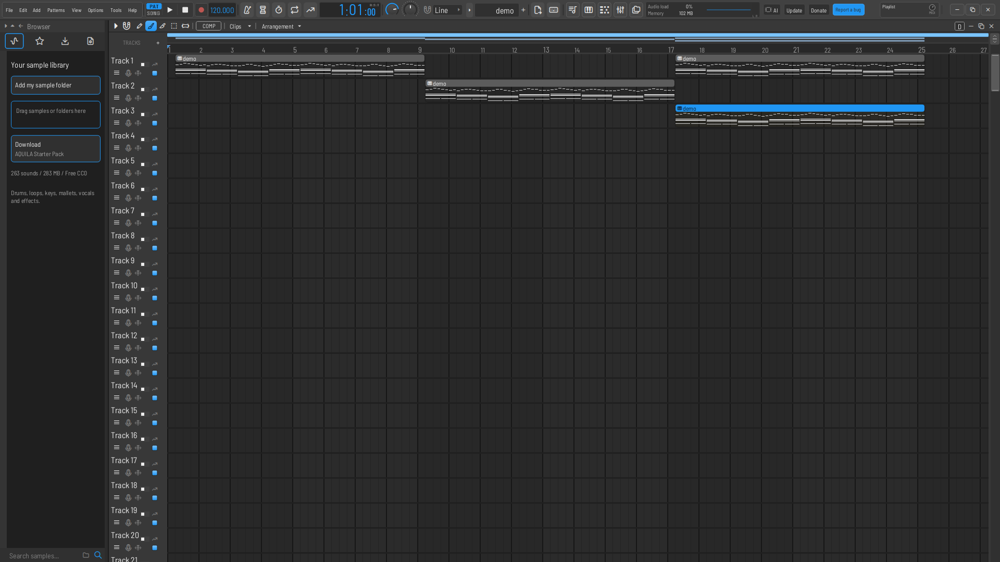
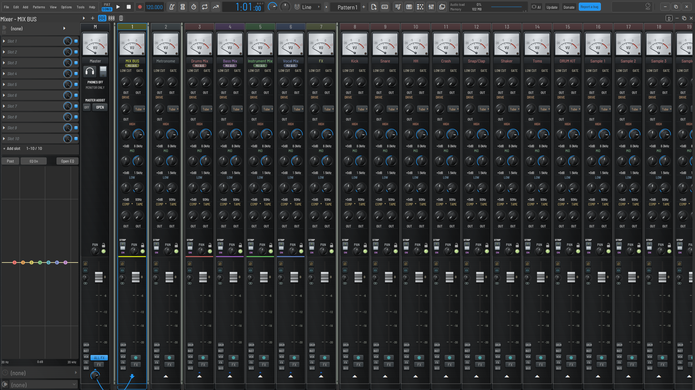
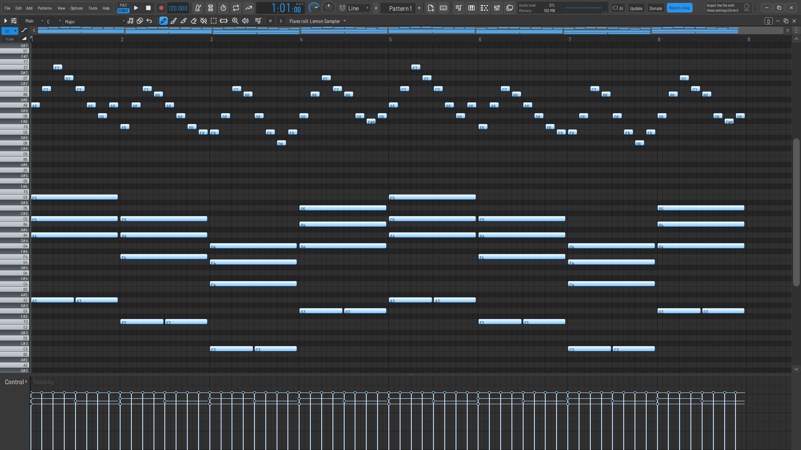

<p align="center">
  
</p>

<h1 align="center">AQUILA</h1>

<p align="center">
  A free, open-source digital audio workstation for Windows, macOS and Linux.<br>
  Pattern-based composing, a full Playlist, studio channel strips, mastering, and live collaboration.
</p>

<p align="center">
  <a href="#features">Features</a> ·
  <a href="#screenshots">Screenshots</a> ·
  <a href="#built-in-instruments-and-effects">Instruments and effects</a> ·
  <a href="#building-from-source">Building</a> ·
  <a href="#keyboard-shortcuts">Shortcuts</a> ·
  <a href="#credits-and-license">Credits</a>
</p>

---

## What AQUILA is

AQUILA is a complete music production environment written in Rust. You sketch ideas as patterns in the Channel Rack and Piano Roll, arrange them with audio and automation in the Playlist, record and comp takes, and mix and master in a studio-style mixer — all in one window, with every built-in instrument and effect included.

AQUILA brings together two lines of development:

- **ML Studio** by Michael Lane, which added analog-style channel strips, the Master Assistant, comping, time stretching, MPE, ARA, stem separation, vocal tuning, live collaboration, a redesigned browser and many workflow tools.
- **Lemon Studio** by ItsAlphaNeon and contributors, the project both are built on. AQUILA includes Lemon Studio's development through November 2026, including multi-core mixing and its newest built-in plugins.

> **Status:** pre-release. AQUILA is usable for real work, but keep backups and work on copies of important projects, especially when moving them between AQUILA, Lemon Studio and FL Studio.

## Screenshots



| Mixer | Piano Roll |
| --- | --- |
|  |  |

## Features

### Compose

- **Channel Rack and step sequencer** with per-channel swing, loop lengths, groups, channel stacks (one pattern playing several instruments) and colour coding.
- **Piano Roll** with ghost notes, scales and harmony helpers, chord stamping, strum, arpeggiator, quantize, legato and chop tools, note properties and slide notes.
- **MPE** for expressive controllers: per-note pitch, pressure and timbre reach plugins that support it.
- **Typing keyboard** (Ctrl+T) to play instruments from the computer keyboard.

### Arrange

- **Playlist** for patterns, audio clips and automation clips, with snapping to clip edges and markers, time markers, take lanes and track folders.
- **Automation** clips with curves and LFOs, plus peak and formula controllers that drive any parameter from audio or expressions.
- **Clip effects**: effects that belong to a single audio clip rather than a whole track.
- **Track freeze and bounce** to free CPU, with unfreeze kept one click away.

### Record and edit audio

- **Mixer input recording** into the Playlist, with take lanes and **comping** to build the best take from several passes.
- **Time stretching and audio warping** to fit loops and recordings to the project tempo.
- **Tesla audio editor** for detailed editing: fades, gain, noise cleanup, time stretch and pitch shift.
- **Vocal tools**: vocal tuning, vocal alignment, and **stem separation** (an optional download) to split a mix into parts.
- **ARA** support for plugins such as Melodyne that edit audio directly in the project.

### Mix and master

- **Mixer** with analog-style and compact layouts, buses, sends, sidechains, track routing and a quick sidechain helper.
- **Channel strips** on every insert: low cut, gate, drive, EQ, compressor and de-esser, with a built-in mixer EQ slot and vocal presets.
- **Multi-core mixing**: mixer tracks and instruments render on several cores, sample-for-sample the same as on one.
- **Plugin delay compensation**, plugin sandboxing (a crashing plugin is stopped, not the studio), and per-plugin CPU monitoring.
- **Master Assistant** for guided mastering on the master track.
- **Third-party plugins**: VST3, VST2 and CLAP instruments and effects, scanned into a searchable plugin picker with previews, favourites and effect chains.

### Work your way

- **Browser** with sample folders, tags, favourites, live sample preview and a free Starter Pack download.
- **Themes and looks**: several designs, an advanced theme editor, custom mixer skins, a classic 2005-style workspace, and adjustable toolbars and menus.
- **Customizable controls**: rebind mouse and keyboard actions and reorganize menus.
- **Live collaboration**: one person hosts from their running AQUILA and others join over the network to edit the same project together. No account or server is needed.
- **AI control (optional)**: a local MCP connection that lets a compatible AI assistant operate AQUILA on your behalf. It is off at every launch and sends nothing anywhere until you turn it on.
- **In-app user guide and change log** under the Help menu.

### Projects and files

- AQUILA saves **`.lmn` projects**: the FL Studio project format with AQUILA's own settings stored alongside.
- It opens `.lmn`, Lemon Studio `.lemon` and FL Studio `.flp` projects, plus zipped projects with their samples.
- Exports WAV, FLAC and MP3 (Ctrl+R, Ctrl+Shift+R), stems per mixer track, and MIDI (Ctrl+Shift+M).
- Autosave and overwrite backups, project templates, and a data folder per project for its recordings and renders.

## Built-in instruments and effects

Every AQUILA install includes these, with no extra downloads.

**Instruments**

| Plugin | What it is |
| --- | --- |
| ML Sampler | Sample playback with envelopes, LFOs, filters, stretching and disk streaming |
| ML Chop | Sample chopper with cues, pads and stems |
| ML Trio | Three-oscillator subtractive synth |
| ML Citrus | Six-operator FM synth |
| Smith | Synthesizer from Lemon Studio |
| ML Plasma | Wavetable synth, adapted from Gridline Plasma |
| ML Wave | Sample-based synth |
| Lemon Slicer | Beat slicer that writes its slices into a pattern |
| Lemon Drum Sampler | Multi-pad drum sampler |

**Effects**

| Category | Plugins |
| --- | --- |
| EQ and filters | ML EQ (7-band parametric with dynamic EQ and analyzer), ML Pulp Filter, Lemon Filter |
| Dynamics | ML Limiter, ML Press, ML Transient Processor, ML Soft Clipper |
| Space | ML Reverb, ML Hall, ML Delay |
| Modulation | ML Chorus, Lemon Flanger, Lemon Phaser |
| Colour and stereo | ML Tape, ML Fast Distortion, ML Stereo Enhancer, ML Stereo Shaper, ML Balance |
| Creative | Lemon Vocoder |
| Control | Lemon Peak Controller, Lemon Formula Controller |
| Analysis and editing | Lemon Drop (spectrum and waveform view), ML Tesla (audio editor) |
| Mastering | Master Assistant |

## System requirements

- **Windows** 10 or 11, x86-64. ASIO and WASAPI audio.
- **macOS** 12 or later, Apple silicon or Intel. Core Audio.
- **Linux** x86-64 with ALSA, PipeWire or PulseAudio.
- A 64-bit CPU with several cores benefits from multi-core mixing. 8 GB of RAM is a comfortable minimum for larger projects.

## Building from source

### Prerequisites

- Rust stable (install with [rustup](https://rustup.rs)).
- CMake, a C/C++ compiler and Python 3. On macOS: the Xcode command line tools. On Windows: Visual Studio Build Tools.
- The platform packages listed in the [Lemon Studio build guide](https://github.com/ItsAlphaNeon/Lemon-Studio#getting-started) (for Linux: ALSA, JACK and X11 development packages).

### Build and run

Clone into a folder whose path contains **no spaces**. The bundled LAME MP3 encoder and the ML Plasma engine use `make`, which breaks on paths with spaces.

```bash
git clone https://github.com/ajdohaxhia/ADE-Studio.git aquila
cd aquila
PYTHON=python3 cargo run --release -p os-app
```

On macOS, if your selected Xcode lives in a folder whose path has spaces (for example on an external drive named `My Drive`), point the build at the Command Line Tools instead: prefix the command with `DEVELOPER_DIR=/Library/Developer/CommandLineTools`.

The first build compiles the ML Plasma engine natively. Before it starts, it checks for **20 GiB of free disk space** on the drive that holds the build folder. To build on another drive, set `CARGO_TARGET_DIR` to a folder there (again with no spaces in its path).

### Packaging

- **macOS app bundle:** `cargo run -p bundle-app` builds `AQUILA.app` with the AQUILA icon; add `-- --install` to copy it to `~/Applications`.
- **Windows installer:** `packaging/windows/LemonStudio.nsi` (NSIS).
- **Master Assistant engine** (release builds): compile `plugins/lemon-master-assistant` with CMake and JUCE 8.0.9, package it with `python packaging/bundle-master-engine.py`, then set `LEMON_MASTER_BUNDLE` to the ZIP and `LEMON_RELEASE=1` before building `os-app`.

### Icons

The logo lives at `crates/os-app/assets/logo/aquila.png`. To regenerate the app icons from it, run `tools/logo/macos-icon.sh` on macOS (`.icns`) and `python tools/logo/gen.py` with Pillow installed (`.ico` and `.png`).

### Tests

```bash
cargo test --workspace --lib --bins --tests
```

## Keyboard shortcuts

| Keys | Action |
| --- | --- |
| Space / Ctrl+Space | Play and stop / play and pause |
| L | Switch between pattern and song mode |
| R | Arm recording |
| Ctrl+H | Stop all sound |
| Ctrl+S / Ctrl+Shift+S / Ctrl+O | Save / Save as / Open |
| Ctrl+N | Save a new version |
| Ctrl+Z / Ctrl+Y | Undo / redo |
| F5 / F6 / F7 / F9 | Playlist / Channel Rack / Piano Roll / Mixer |
| F8 | Plugin picker |
| Ctrl+R / Ctrl+Shift+R / Ctrl+Shift+M | Export WAV / MP3 / MIDI |
| Ctrl+B | Duplicate selection |
| Ctrl+Q / Ctrl+L / Ctrl+U | Quantize / legato / chop (Piano Roll) |
| Ctrl+T | Typing keyboard to piano |

Every shortcut can be changed under Options ▸ Controls.

## Repository layout

| Path | Contents |
| --- | --- |
| `crates/os-app` | The application: windows, editors, browser, mixer, transport and file handling |
| `crates/os-engine` | The audio engine: scheduling, voices, mixing, multi-core rendering, delay compensation |
| `crates/os-dsp` | DSP building blocks: channel strip, EQ, stretching, resampling |
| `crates/os-model` | The project model shared by every part |
| `crates/os-flp` | Reading and writing FLP, `.lmn` and `.lemon` project files |
| `crates/os-host`, `os-vst2`, `os-vst3`, `os-clap` | Third-party plugin hosting |
| `crates/os-ui`, `os-theme` | Drawing, widgets and themes |
| `crates/os-collab` | Live collaboration |
| `plugins/` | The built-in instruments and effects |
| `tools/` | Bundling, logo generation and developer tools |
| `docs/` | Design notes and the user guide |

## Known differences from Lemon Studio

Where ML Studio and Lemon Studio built the same area differently, AQUILA keeps ML Studio's version:

- The mixer and Playlist look, menus and animations are ML Studio's. Lemon Studio's docked mixer strips, waveform view and strip arm buttons don't appear.
- Playback uses ML Studio's audio transport. Lemon Studio's disk recording into armed mixer tracks, count-in and multi-output devices are not active; ML Studio's own mixer recording is.
- The file browser is ML Studio's, with its own favourites and tags.
- Projects are saved as `.lmn`; `.lemon` files open but are saved as `.lmn`.

## Credits and license

AQUILA is based on [ML Studio by Michael Lane](https://github.com/Dorfhaus/ML-Studio) and [Lemon Studio by ItsAlphaNeon and contributors](https://github.com/ItsAlphaNeon/Lemon-Studio). Their full source history is preserved in this repository. ML Plasma is adapted from Gridline Plasma.

AQUILA is free software under the GNU GPL v3 or later. The Windows build includes the ASIO SDK and is therefore under GPL v3 only. See the [license](LICENSE) and the [third-party notices](THIRD-PARTY-NOTICES.txt) for the terms of every included component.
