# ML Studio User Guide

## Start here
Overview: Install, set up audio, and make your first song.

### Make your first song
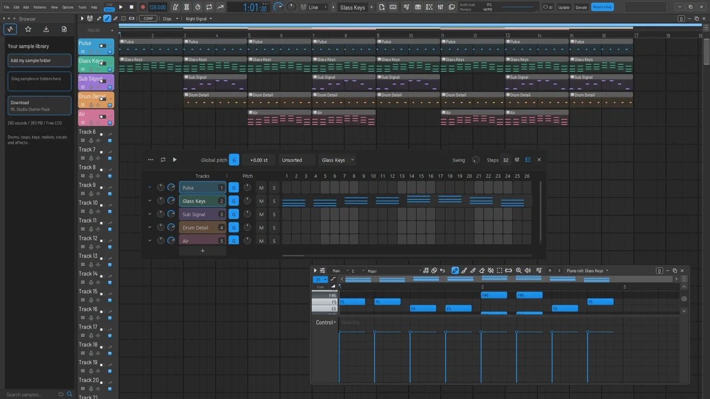
Keywords: beat beginner first project getting started
Related: Understand the main windows | Set up an audio device | Program steps and patterns | Export a finished song, stems or MIDI
Guide: rack-steps
1. Use File > New to start with your default template. Set the template in General settings and choose an output device in Options > Audio settings.
2. Add an instrument with the Add menu or the plugin picker. Open the Channel Rack and click steps on a drum channel to make a beat.
3. Right-click an instrument's row and open Piano Roll to draw notes. Play in Pattern mode to hear the current pattern.
4. Open the Playlist, choose the pattern and click a track to place it. Switch to Song mode to hear the arrangement.
5. Save the project, then use File > Export audio to create an audio file.

### Understand the main windows
Keywords: workspace browser mixer channel rack piano roll playlist arrangement

Related: Show a window or restore your workspace | Build an arrangement | Set levels, pan and routing
The Channel Rack holds instruments, samples and step patterns. Piano Roll edits notes for one channel in the current pattern. The Playlist arranges patterns, recordings and automation over time.
The Mixer controls audio level, pan, effects and routing. The Browser finds samples, projects and presets. Use the toolbar shortcuts or the View menu to show these windows.

### Set tempo and play the right thing
Keywords: bpm metronome transport playback loop song pattern space

Guide: transport
Choose PAT to hear the current pattern or SONG to hear the Playlist. Press Space to start or stop, or use the toolbar transport.
Adjust BPM in the toolbar. Enable the metronome to hear the beat and click in the Playlist ruler to set the playhead.

### Browse or search the User Guide
Keywords: offline help manual collapsible sections topics find
Open Help > User Guide. Choose a chapter from the home page or Contents sidebar, then select an article. Use Back to return to the previous article or list position, Home to return to the chapter index, and Related articles or Previous / Next article to keep reading.
Press Ctrl+K or Ctrl+F to focus search, then enter a feature, shortcut or task. Enter opens the first match. Click a picture to enlarge it and Escape to return. Where available, Show me where points to the matching control in the workspace. Return to Guide restores the article.

Use Detach at the top of the guide to open a resizable native window. Drag its title bar to another monitor and keep editing the project in the main window. Use Dock to return to the app. Close hides the guide, and Help > User Guide reopens it in its last mode. Workspace Visibility > Help can hide the Detach button.

### Install and open ML Studio
Keywords: download install Windows macOS Apple silicon Intel Linux update .lmn first launch
Get the installer or archive for your operating system and processor from the official ML Studio downloads page, https://michaellanemusic.de/ml-studio/. Windows uses the installer. On macOS, choose Apple silicon or Intel, then place the application in a writable Applications folder. On Linux x86-64, extract the full archive into a writable folder and launch ML Studio from it.
1. Start ML Studio and open Options > Audio settings. Pick your interface or built-in output.
2. Use File > New from template to choose a starting workspace. Lemon Starter is the supplied starting template.
3. Use Help > About to identify your build. Help > Change Log lists the installed release history. When a signed update is available, the update control downloads it and offers a restart.
Related: Make your first song | Set up an audio device | Report a problem and check for updates

### Read the toolbar and project time
Keywords: toolbar hint time display song position varispeed output monitor cpu pattern snap recording
The hint area describes the control under the pointer. PAT and SONG choose what transport plays. Use the pattern selector to choose the current pattern and the Global snap selector to set the shared editing grid. Editors with an independent snap setting can follow the global choice or override it.
The main level and master mixer fader control different stages of the output path. Check both if the signal is low. The main pitch or varispeed and the tempo controls affect playback. For a local clip timing change, use that clip's settings or Audio Timing.
The output monitor can show a triggered stereo waveform, peaks, processing load, memory and underruns. Options > CPU meter switches among Compact, Classic FL-style, and Lemon live monitor. Use the counters while reproducing an audible problem.
Guide: transport
Related: Set tempo and play the right thing | Fix delay, crackles or no sound

## Audio & recording
Overview: Choose devices and record audio, MIDI and automation.

### Set up an audio device
Keywords: sound output speakers headphones interface asio wasapi coreaudio buffer latency
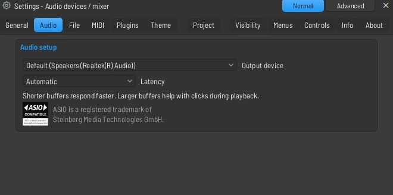
Related: Record a microphone or instrument | Fix delay, crackles or no sound
Guide: audio-device
Open Options > Audio settings. Choose an output device and verify that the device's sample rate and channels match your interface settings.
Start with a buffer that plays reliably. Lower it if monitoring feels delayed, or raise it if playback crackles or the underrun count rises. On Windows, select your interface's ASIO driver if available.

### Record a microphone or instrument
Keywords: record vocals guitar interface input arm monitor take
Related: Prevent feedback and choose a recording input | Comp and organize takes
Guide: record
1. Select an empty Mixer insert and choose your interface input in its input selector.
2. Check that the meter moves and set a safe input level on the interface. Arm disk recording on the insert.
3. Enable recording and choose audio recording if prompted. Start playback, perform the take, then stop and check the recorded clip.
Use headphones when monitoring a microphone. If the sound is doubled, check whether both interface direct monitoring and software monitoring are active.

### Prevent feedback and choose a recording input
Keywords: record dry mono stereo left right input monitoring bleed
Guide: mixer-input
Use a mono input for a single microphone or instrument, and a stereo pair for a stereo source. Verify the input selector on the Mixer track before arming it.
Listen on headphones and disable any unintended second monitoring path. Record a short test, then play it back to check the level, channel balance and timing.

### Record notes from a MIDI keyboard
Keywords: midi controller record piano keyboard velocity
Guide: midi
Enable the device in Options > MIDI settings. Select the instrument channel, test a few notes, then enable recording and select note recording if prompted.
Start playback in the desired mode and perform. Open the pattern's Piano Roll to correct timing and velocity.

### Fix delay, crackles or no sound
Keywords: latency underruns cpu stutter dropout silence device troubleshooting
Guide: audio-buffer
If nothing plays, check the output device, master level, muted tracks, song/pattern mode and routing to Master. If only one channel is silent, check its sample or plugin and its Mixer destination.
For dropouts, raise the buffer and temporarily bypass expensive effects to isolate the cause. Freeze or bounce finished parts if needed.
Playback keeps one full device buffer in reserve, with a 3 ms minimum, to tolerate closely spaced audio callbacks. Small buffers remain best for live playing and recording. Larger buffers provide more protection but also increase the time before edits or live notes are heard.
Plugin delay compensation aligns paths using delays reported by plugins. Input monitoring still has hardware and processing latency, so use a small stable buffer or direct monitoring when recording.

### Set up a keyboard or mixer controller
Keywords: MIDI controller Komplete Kontrol KeyLab Arturia Behringer X-Touch nanoKONTROL Akai Novation Launchkey M-Audio Nektar Mackie MCU
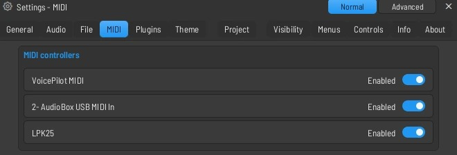
Guide: midi
Open Settings > MIDI, select an input device, enable it and choose its Controller type. This choice is saved separately for each device in your profile.
For musical keys and pads, choose Generic MIDI / MIDI Learn. Use the input role to separate an instrument port from a dedicated DAW controls port. Use Instruments + controls when a keyboard has one shared port. Right-click a software knob, choose Link to controller, then move the hardware control. For an endless encoder, choose the Relative mode that matches its MIDI format.
Under DAW MIDI Learn, select an action and press a hardware button on the selected input. Single press mode suits CC buttons that send no release. Save Learn preset exports the actions and button behavior to a file. Load Learn preset applies that file to the selected input and replaces its learned actions.
For a controller with Mackie Control Universal support, set its hardware mode to MCU, select its dedicated DAW input in ML Studio, and choose Mackie Control or the matching named MCU profile. Profiles include Kontrol, KeyLab, X-Touch, Oxygen Pro, nanoKONTROL Studio, SSL UF1/UF8 and iCON QCon. Use the hardware's matching Mackie mode. Select the dedicated DAW output in the output list, then click Pair selected output. Hardware with compatible motor faders, button LEDs, pan rings or track-name displays receives feedback over that output.
For Launchkey MK4, select its native profile on the DAW input and pair the DAW output to enter DAW mode. Its DAW pads select and mute Mixer inserts, and its mixer encoders and available faders control pan and level. Keep the instrument port available for playing keys. The nanoKONTROL2 factory profile uses CC mode. For Akai and other controllers configured to transmit MIDI Machine Control, choose the MMC profile to receive transport commands alongside notes.
If notes work but transport does not, turn on the MIDI Monitor and check whether pressing a button generates a message on the selected DAW port. If an input shows in use, close the other application using that MIDI port. Use Refresh device list after connecting hardware.
Hide the setup controls under Settings > General > Workspace Visibility > Input customization > MIDI controller setup. Saved modes and mappings continue to operate when the controls are hidden.

### Use MIDI, typing keyboard and step entry
Keywords: step edit typing keyboard controllers performance
Guide: typing
Enable Typing keyboard to piano in the toolbar or press Ctrl+T. ML Studio remembers the switch in your profile when you quit and reopen. Notes go to the selected instrument. Use numpad + and - to shift the keyboard by octaves. Right-click the typing-keyboard button and choose Octave to set the base octave directly, including on keyboards without a numpad. The octave is saved per profile; 4 is the default. Octave changes apply to new notes, so held notes still release at their original pitch. Settings > Visibility > Input customization can hide the octave menu without changing the setting.
Right-click the toolbar button to choose Key and Scale or Follow Piano Roll typing snap. For a selected scale, the letter rows play successive scale notes and each row starts one octave above the previous row. On a German QWERTZ keyboard, the bottom row runs from Y through minus and the home row from A through Ä. The corresponding QWERTY ranges are Z through slash and A through apostrophe. Choose Chromatic for the staggered piano-key layout with black keys on the row above.
Turn typing off to use the same unmodified keys for editing shortcuts. Text fields take text normally and modified keyboard shortcuts keep their own bindings.
Use Step Edit with playback stopped to enter notes one step at a time. Check the selected channel, current position and snap before entering notes.
Use MIDI settings to configure enabled devices and controller inputs. Save a small test project before setting up a complex controller mapping.

### Enter notes one step at a time
Keywords: step edit step recording midi chord input
Guide: step
Stop playback and enable Step Edit in the toolbar. Select an instrument and set the playhead and snap.
Play a note or chord from a MIDI or typing keyboard. Each entry advances by one snap step. Turn Step Edit off before returning to live playing.

### Choose a recording mode and lead-in
Keywords: record filter notes audio automation count in precount preroll pre-roll loop blend start on input metronome cancel
Right-click Record to check which recording types are enabled. Arm a Mixer insert with a hardware input for audio, select an instrument for notes, and enable automation recording before moving controls during a take. Make a short test take and verify where the result lands.
Right-click Recording precount to choose Off, a count-in, or pre-roll of 1, 2, 4 or 8 bars. Pre-roll plays the existing arrangement before the recording point, so you can hear your cue. The take begins at the intended point. Pre-roll clamps to the start of the song, and stopping during the lead-in leaves no take. Start on input waits for a qualifying input. Blend recorded notes adds new notes to the active material, and Loop record repeats the selected range.
Use the metronome or choose a separate Mixer track for it in Advanced audio settings. Use Tools > Cancel recording if you want to discard the current recording. Stop normally to keep the take.
Guide: record
Related: Record a microphone or instrument | Record notes from a MIDI keyboard | Comp and organize takes

### Set up inputs, monitoring and recording placement
Keywords: input monitoring latency dry wet record external direct software monitoring offset stereo interface
Select an input on a Mixer insert and watch the input meter. A mono input is appropriate for one microphone. A stereo input pair is appropriate for an interface receiving a stereo source. Arm the intended insert and check which Playlist track is linked or selected for the take.
Use one monitoring path to prevent hearing a direct and a delayed copy together. Interface direct monitoring gives a dry cue with minimal delay. DAW monitoring lets you hear the mixer route and its effects. A low stable buffer helps when monitoring through the app.
Test timing with a known transient before adjusting Recording offset under Audio > Advanced. A positive offset places audio later. Choose 32-bit float, 24-bit PCM or 16-bit PCM to suit the recording workflow. Trim the source or adjust clip gain for later edits.
Guide: mixer-input
Related: Prevent feedback and choose a recording input | Audio processing and recording settings

### Recover a played phrase with the score log
Keywords: score logger dump last played midi notes retrospective history clear
If you played an idea without recording, select the target pattern and instrument, then open Tools > Dump score log to selected pattern. Choose a time window from the submenu. Open the Piano Roll to trim, move or quantize the resulting notes.
The score log is for played note input. Use audio recording or Tesla to capture an audio signal. Tools > Clear log clears the remembered note input.

## Channel Rack & Piano Roll
Overview: Build patterns, program notes, and shape expression.

### Add, replace and route an instrument
Keywords: channel rack generator vst synth sampler insert instrument
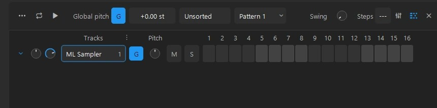
Guide: rack-route
Use Add or the plugin picker to create an instrument channel. To insert another instrument from the rack, right-click a row and choose Insert instrument.
Use the rack channel's Mixer track assignment to send its sound to an insert. Name the channel and insert so they are easy to find again.

### Program steps and patterns
Keywords: drum sequencer swing kick snare hi hat pattern

Guide: rack-steps
Choose or create a pattern. Click a step to turn it on or off, and play in PAT mode to audition it.
Keep variations in separate patterns so they can be arranged independently. Adjust swing to change the feel and use per-channel loop lengths where available.

### Draw, move and edit notes
Keywords: piano roll pencil brush select resize velocity note properties
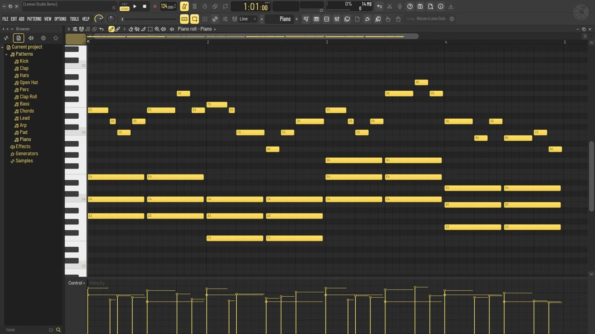
Related: Quantize and shape notes | Edit per-note expression with MPE | Work with chord and scale tools
Guide: piano-notes
Open a channel's Piano Roll. Use Draw to add notes, drag a note to change time or pitch, and drag its edge to resize it.
Use Select to work on several notes. Right-click empty space with Draw or Brush to clear selection. Use the lower lane to edit velocity or other note values.
Double-click a note to inspect its properties. Set snap according to the grid you want before moving or resizing notes.

### Use Glide Notes and slide pitches
Keywords: glide slide portamento normal note type
Guide: piano-notes
Choose Glide Note in note properties to place a glide. Select an existing normal or glide note to pick up that placement type.
Place a glide against a sounding note on a compatible instrument and adjust its length to control the transition. Check the result on the instrument you are using, since third-party plugins can handle note slides differently.

### Zoom, navigate and place patterns
Keywords: piano roll alt wheel vertical zoom place pattern playlist toolbar
Guide: place-pattern
Use Alt + wheel over Piano Roll to resize note rows vertically. Use the horizontal overview to move through the pattern and the vertical controls to bring the notes into view.
Use Place Pattern to Playlist in the Piano Roll toolbar to put the current pattern at the Playlist playhead. It finds the first track with space for the clip, opens the Playlist and highlights the result.

### Quantize and shape notes
Keywords: quantize timing strum arpeggio flam chop glue legato flip randomize
Guide: piano-tools
Select the notes to process, then open the relevant command in the Piano Roll Tools menu. Quantize adjusts timing toward a grid. Strum offsets chord notes, and Arpeggiate turns chord notes into a repeating sequence.
Use Chop to split notes, Glue to join suitable notes and Legato to extend notes toward the following ones. Preview the tool, apply it, or cancel to keep the original.

### Edit per-note expression with MPE
Keywords: mpe pitch bend pressure slide timbre controller lanes
Guide: piano-mpe
Open MPE / Note expression in the Piano Roll menu. Enable it for the instrument and show the expression lanes. Use a compatible instrument or patch and match its pitch bend range.
Select one note to edit its expression curves. For a hardware controller, also match its zone and member channels to the instrument settings.

### Work with chord and scale tools
Keywords: chord workspace harmony key scale scale highlighting chord progressions
Guide: chords
Open Chord Workspace from the Piano Roll shortcut where shown. Choose a scale or chord and audition it in the current instrument before placing notes.
Use the Piano Roll's scale guides as a reference. If the shortcut is hidden, look under Settings > Visibility > Piano Roll.

### Resize lanes and use the pattern overview
Keywords: piano roll minimap scroll zoom velocity lane splitter
Guide: piano-overview
Drag the splitter above the lower event lane to give it more space. Double-click the splitter to hide or show the lane.
Use the overview scrollbar to move through a long pattern. Zoom in for small edits and out to check the whole phrase.

### Edit velocity and note expression
Keywords: velocity pan release note properties ghost notes scale key event
Guide: piano-expression
Use the Piano Roll lower lane to change velocity and other available note properties. Select notes first when you only want to change part of a phrase.
Use ghost notes for reference to other channels and key or scale guides to see usable pitches. Drag the lane splitter to make the editing area taller.

### Select and edit several channels
Keywords: rack marquee multi select group rows drag mute solo reorder pitch pan volume delete clone
Drag across the channel selectors to select a range. Shift-click selectors to extend a range. On a selected row, mute, solo and supported Pitch, Volume or Pan moves apply to the selection. Pitch, volume and pan edits preserve relative values within the selected group where the control range permits. Delete removes the selected channels. Check the project Undo history before making a second large edit.
Ctrl-drag a row to reorder it. If it belongs to the selection, move the selected rows together and use the insertion line as a guide. The Channel Rack Options > View > Auto resize choice offers Off, Minimum height and Maximum height. A rack with more rows than fit can scroll.
Use Clone for another channel or Clone (Complete) when you need independent pattern material and supported automation, plugin state and matching Playlist placement. Review the clones and their routing before changing shared effects.
Related: Route selected channels to the Mixer | Program steps and patterns

### Route selected channels to the Mixer
Keywords: mixer assignment group routing consecutive destination selected rack channels wheel drag miniature
Select the instrument or sample rows first. Open the routing command from a channel or Mixer-number context menu and choose a shared insert or consecutive destinations. Consecutive routing follows rack order. Automation channels are skipped.
Wheel the Mixer number on a selected channel or drag that number to an insert to route the selection together. On an unselected channel the same gesture routes just that row. Escape cancels a routing drag. Locked inserts or an insufficient run of destinations reject the full group change. Undo and project saving include the routing change.
Guide: rack-route
Related: Route audio with the miniature Mixer picker | Set levels, pan and routing

### Manage and render patterns
Keywords: patterns find empty rename color time signature transpose clone split channel render replace
Use Patterns > Find next empty to start a pattern and Rename and color to identify it. Clone when you want a variation. Select in playlist locates occurrences, and Open in project browser finds the pattern in the Browser. Move up and Move down reorder patterns. Insert one, Delete, Set time signature and Transpose act on the chosen pattern.
Use Split by channel to break a combined pattern into channel parts. For audio, choose Quick render as audio clip, Render as audio clip for options, or Render and replace to substitute the result in the arrangement. Keep the editable pattern if you expect to change its notes later.
Related: Program steps and patterns | Build an arrangement | Freeze or bounce a track

### Edit note properties and the event editor
Keywords: double click note properties velocity pan release fine pitch Mod X Mod Y probability event lane
Double-click a note to open its properties and edit timing, length, pitch and supported per-note values. Use the lower event editor to edit values across several notes, such as velocity, pan, release, fine pitch and modulation. Choose the property from the target menu and check the selection before drawing a series of changes.
Use the lane divider to reveal more of the event editor. Change the vertical pitch zoom independently when you need more room between notes. Individual plugins determine which note-expression values affect their sound. Use the MPE editor and a compatible instrument for per-note MPE expression.
Guide: piano-expression
Related: Draw, move and edit notes | Edit per-note expression with MPE

### Use the Piano Roll editing tools
Keywords: piano roll menu draw paint delete mute slice select zoom snap glue strum flam arpeggiate claw limit randomize flip scale levels
Choose Draw for a single note, Paint for repeated placement, Select for a marquee, Slice to cut, and Mute to silence notes without deleting them. Check the current snap before placing or moving notes. Ctrl/Cmd+Shift-drag draws a selection marquee in supported editing contexts. Right-drag with editing tools can erase.
Open the Piano Roll Tools menu to find note-processing commands. Quantize changes timing or length against the grid or a groove. Strum spreads note starts, Arpeggiate makes a note sequence, Flam creates closely spaced attacks, and Flip mirrors pitch or time. Scale levels, Randomize, LFO and other event tools shape the selected data. Preview the result where the dialog offers it and cancel to keep the original.
Use the Piano Roll snap and scale controls to guide placement. A project key, highlighted scale or ghost-note display can help orient you while editing a different channel. To work against other Playlist parts, use the shared MIDI clip timeline.
Guide: piano-tools
Related: Quantize and shape notes | Work with chord and scale tools | Edit several MIDI clips on one timeline

## Playlist & editing
Overview: Arrange clips and edit performances on the timeline.

### Build an arrangement
Keywords: playlist clips tracks markers patterns drag arrangement
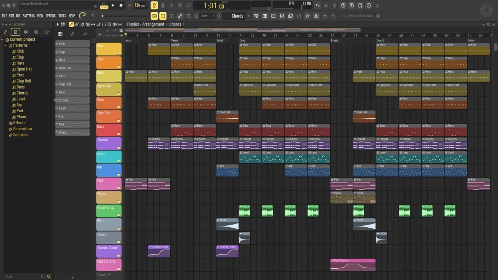
Related: Use the clips picker and loop previews | Import, trim and fade audio | Attach the Mixer to the Playlist
Guide: clip-picker
Choose a pattern, audio clip or automation source, then place it on the Playlist. Drag a clip to move it and use its edges to trim it. Turn on snap for grid-aligned placement.
Use the Playlist tools to draw, paint, split, mute or select clips. Right-click the ruler for marker commands and use the Arrangement selector to manage versions of the song.

**Follow playhead** is off by default. During playback you can scroll or zoom the Playlist yourself. To keep the playhead in view automatically, use Options > Follow playhead or the matching toolbar button. Right-click the button to choose between continuous scrolling and page advances. Your choice is saved in your profile.

### Use the clips picker and loop previews
Keywords: clip picker pattern picker preview audition loop stop playlist left panel
Guide: clip-picker
In the Playlist menu, enable Show clip picker panel. Its tabs separate patterns, audio and automation. Click a row to choose what to place.
Click the Play icon on the right to loop an audio clip or supported pattern. Click Stop on the same row or start another preview. For a pattern that relies on a hosted third-party instrument, render it to audio before auditioning it here.
Show or hide the preview buttons in Settings > Visibility > Playlist.

### Import, trim and fade audio
Keywords: sample drag wav mp3 audio clip fades crop stretch
Guide: stretch
Drag an audio file from the Browser or your file manager into the Playlist. Use the clip edges to trim, the fade handles to ease in or out, and the clip menu for source commands.
Use Stretch mode when dragging an edge should change the clip's timing. Turn it off to return to trimming. Use the audio channel's settings for pitch or stretching method.

### Make a clip independent
Keywords: make unique clone duplicate shared audio channel route
Use Make unique in the clip menu before changing a source that several clips share. Edits to a shared source can affect other instances.
After making it unique, rename the new source and make the change there. Use a unique audio channel when two instances need separate Mixer destinations.

### Set up an alternate arrangement
Keywords: arrangement duplicate playlist version marker sections
Guide: arrangement
Use the Arrangement selector to manage alternate versions of the Playlist. Keep a separate arrangement for an alternate edit or song structure.
Review which arrangement is active before recording, bouncing or exporting. Patterns and channels can still be shared between arrangements.

### Edit audio timing with warp markers
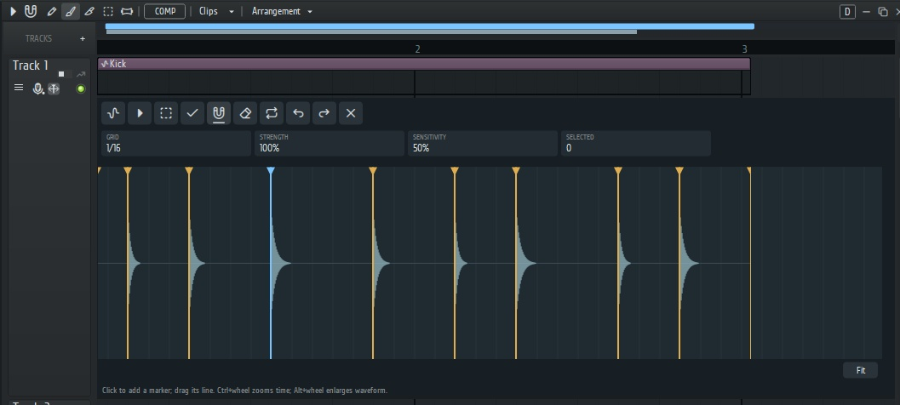
Keywords: warp transient flex time guitar rhythm audio timing detect quantize snap
Related: Fit a loop or use its detected tempo | Align multiple performances | Tune vocals in the Playlist
Guide: warp
1. Click the timing-pin button on the Playlist track, or open Edit audio timing from an audio clip's menu. The editor detects transients in the clip.
2. Click a detected line to create a timing marker. Drag anywhere along a movable marker line to adjust timing. Use Snap to follow the selected grid.
3. Choose Select and drag across several points. Shift-drag adds more. Use Quantize to move the selection toward the grid, and choose Grid and Strength before quantizing.
4. Use Sensitivity to control transient detection. Click the value to choose 0–100%, or wheel over it for 1% adjustments. Higher values detect quieter attacks; 50% keeps the original detection threshold. Changes filter the detected markers immediately after analysis and are remembered per profile. They do not move or remove timing anchors already edited. Use Detect transients to rerun analysis, then Quantize when ready. Settings > Visibility > Playlist can hide the sensitivity control without changing its value.
5. Use Ctrl + wheel to zoom time, Alt + wheel to scale the waveform display, and Fit to see the whole clip. Changes render automatically after you release a drag or finish a command. Close keeps completed edits; Escape during a drag cancels that gesture. Updating means the last successful audio is still playing until the new render is ready.

### Fit a loop or use its detected tempo
Keywords: detect sample tempo loop bpm stretch fit make it fit project tempo
Open an audio clip's menu and choose Detect sample tempo. The dialog displays the detected BPM. Choose Yes to set the project tempo to that value, or Cancel to keep the current tempo. The tempo change supports project Undo.
To keep the project tempo and fit the clip to it, use the Stretch / fit options. Compare automatic fitting against half-time, double-time, a known source BPM, or a specified number of bars or beats. Check both the start and end of the loop against the grid.

### Separate stems from a clip
Keywords: stem separation vocals drums bass other model download retry
Open a Playlist audio clip's menu and choose Stem separation. Select the stems you want to create. On first use, confirm the download of the optional engine and model. Setup requires an internet connection and several gigabytes of space. Processing runs locally after setup.
The finished stems are separate audio files and Playlist tracks. Keep the project data folder with the session when sharing it. If setup fails, choose Stem separation again to retry. Details are written to setup.log in the Stem separation folder.

### Align multiple performances
Keywords: vocal align vocalign dub guide timing takes imported vocals instruments
Select at least two audio clips, including the guide, then right-click the intended guide and choose Vocal Align to this clip.
Click Analyze and compare the guide, original and aligned views. Adjust Tightness and listen to the preview before applying. Imported clips work as well as recorded takes. Matching phrasing and comparable source sections give better results.
Use a guide that already has the timing you want. Check sustained, quiet or poorly matched sections by ear.

### Tune vocals in the Playlist
Keywords: pitch correction vocal tuning melody notes formant tune
Guide: vocal
Click the microphone icon on the track with the vocal clip to expand the tuning editor. Let it detect notes, then use the editing tools to select notes and adjust pitch or timing where supported.
Pitch edits and timing share the original recording and remain independently editable. Use Undo/Redo pitch edits or Undo/Redo timing for the active clip, or Ctrl+Z/Ctrl+Y for project history. Copies and slices inherit edits and then become independent. Undo timing on a slice keeps its timeline boundaries fixed. Up to 64 steps per layer are saved with the project. Closing an editor keeps completed edits; Escape cancels the current drag. Workspace Visibility can hide editor and clip-history controls without changing playback.

Fresh playback, export, and consolidation wait for current audio edits. A failed update retains previous audio and offers Retry. Existing rendered projects remain playable; older baked edits can only be recovered when their original sources and metadata are available.

### Comp and organize takes
Keywords: take lanes comping record vocals alternatives
Guide: comp
Right-click the Playlist track and choose Create take lanes / comp when available. Keep alternate performances on lanes under the same parent.
Use the comp tool to choose sections for the main take. Audition transitions and adjust boundaries or fades before bouncing a final take.

### Freeze or bounce a track
Keywords: render new track replace cpu bounce audio freeze unfreeze
Guide: track-menu
Right-click a Playlist track header. Freeze track renders the track to save CPU and allows you to return to the editable sources with Unfreeze.
Use Bounce audio > Bounce audio in new track to keep the source on its own track, or Bounce and replace track to work with the rendered clip in place. Save first and compare the result, especially when effects and routing are important.

### Arrange with groups, markers and zoom
Keywords: playlist overview minimap group clips ruler zoom scroll
Guide: playlist-overview
Use the overview above the Playlist to navigate. Drag the thumb to move the view and drag its ends to change the horizontal range.
Group related clips when they should move together. Use time markers to label sections and, where applicable, set start, loop or skip behavior. Use the Playlist snap choice before moving an entire section.

### Select, group and move Playlist tracks
Keywords: folder grouped tracks drag header selection collapse multi-track marquee height reorder
Click or drag down the track names to select rows, including empty lanes. Shift-click extends the selection. Ctrl-click on Windows/Linux or Cmd-click on Mac toggles individual tracks. Ctrl/Cmd+Shift-drag in the timeline draws a marquee around clips.
Right-click a selected track header and choose Create folder. Only selected rows move into the new folder in their existing order. Collapse the folder to save vertical space, expand to edit its children, or dissolve it from its menu. Drag a row or selection by the header handle to reorder it or place it in a folder. Use track groups for related lanes and keep take lanes with their leader.
Resize track heights to show more waveform or automation detail. The Playlist retains track order, names, colors and grouping with the arrangement. Undo can restore structural edits.
Guide: track-menu
Related: Arrange with groups, markers and zoom | Comp and organize takes

### Edit several MIDI clips on one timeline
Keywords: edit selected MIDI clips together ghost notes outlined parts midi import Playlist pattern placement
Select pattern clips in the Playlist and choose Edit selected MIDI clips together. Their notes appear on a shared song timeline. Click the outlined notes of another clip, or use the MIDI parts menu, to make that clip editable. The editor uses the clip's position, trim and pattern speed.
Drop a MIDI file onto the Playlist grid to create a pattern and place it at the selected lane and snapped beat. For a full import, choose File > Import > MIDI file and review the import settings. Undo a mistaken drop before reimporting it.
Related: Draw, move and edit notes | Import and export MIDI files

### Normalize audio and remove silence
Keywords: normalize peak RMS LUFS clip gain batch strip silence threshold attack hold release lookahead
Select audio clips, open Normalize audio clips and enter a Peak, RMS or integrated LUFS target. The operation adjusts each clip's gain individually. Reset sets selected audio clip gains to 0 dB. Clip gain handles apply a relative change when you drag one of the selected clips.
Open Strip Silence to trim quiet starts and ends or split internal gaps. Easy calculates a level for each clip. Manual lets you set open and close thresholds, attack, hold, release and look-ahead. Pick split or trim-only behavior, check the result and use Undo if speech, attacks or tails were cut too closely.
Fades and automatic crossfades smooth transitions where clips overlap. A gain adjustment changes playback level. Use an audio editor or a rendered copy when you want a new sample file.
Related: Import, trim and fade audio | Clean up audio in Tesla

### Process clips, render edits and keep source audio
Keywords: audio processing clip FX reverse make unique stretched automation gain edit sample render bake
Open an audio clip's menu for its processing and editing actions. Use Make unique before changing a shared source if other placements must retain their existing sound. Use Make unique as sample when you need a separately saved audio file.
Clip gain, fades and timeline trimming are Playlist edits. Audio Timing and Vocal Tuning have their own apply and undo paths. Applying one to an already rendered result can bake the previous edit into the new audio. Read the confirmation before combining them.
When an ARA editor is active, render its edit to ordinary audio before applying unsupported clip-processing operations. Keep the project's Rendered folder and referenced audio when moving or archiving the session.
Related: Make a clip independent | Edit audio timing with warp markers | Tune vocals in the Playlist | Use an ARA audio editor

### Control playback, looping and navigation in the Playlist
Keywords: follow playhead auto scroll loop song selection time marker play start overview scroll zoom
Drag in the ruler to make a time selection. Use the play-start marker to choose a return point and the horizontal overview or scrollbar to navigate far away from it. Change Playlist snap for accurate clip moves at the current zoom.
Follow playhead scrolls during playback to keep the playhead in view. Turn it off to edit a distant passage while the song continues playing. The right edge can scroll as you drag, paint or place material. Scroll or zoom first when precise placement is easier at a closer view.
Use time markers to label sections and to return to song positions. Use arrangements for alternate versions of the timeline within one project.
Related: Build an arrangement | Set up an alternate arrangement | Arrange with groups, markers and zoom

## Mixer & routing
Overview: Route signals, build effect chains, and master a mix.

### Set levels, pan and routing
Keywords: mixer volume pan master signal flow insert route
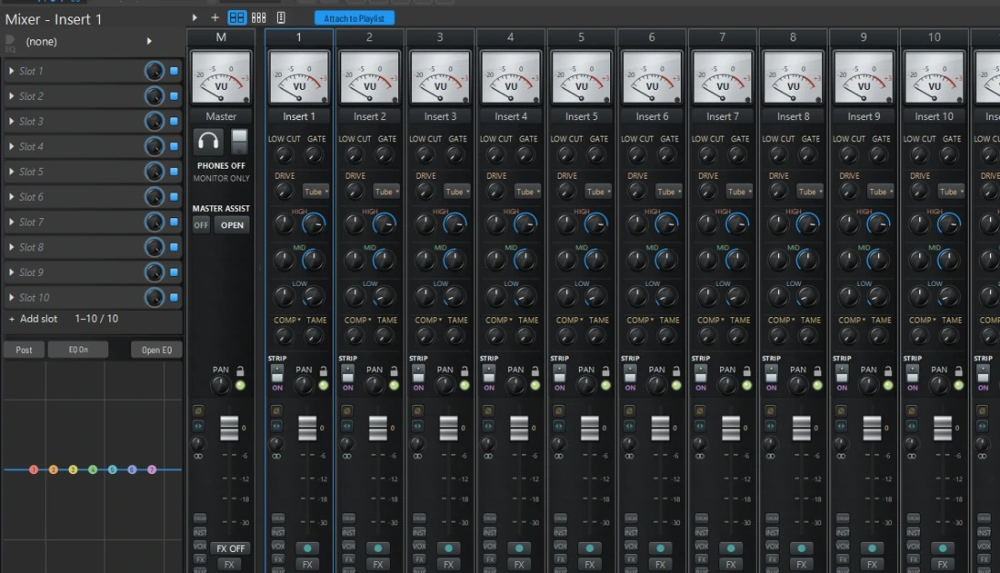
Guide: mixer-level
Route a Channel Rack instrument or audio clip to a named Mixer insert. Use its fader and pan controls to balance it, and check its meter.
Right-click a Mixer channel to rename it or choose Change color > Custom color. The custom swatches accept six-digit hex colors. Settings > General > Input offers optional double-click reset for faders and knobs and opening main menus on hover. Both start off.
Effects in the insert's slots run in order. Check that the track reaches Master through a direct route or a bus. Avoid clipping the Master if you are exporting a mix.

### Send a Mixer track to an interface output
Keywords: hardware output cue headphone mix out extra stereo pair asio
Open a Mixer track and click Hardware out below its EQ. Choose an additional pair exposed by the active audio device, such as Outputs 3 / 4, or choose Off. The output gets the track's post-fader signal alongside its normal sends. Master plays through the device's main outputs.
The choice is saved with the project for that device and affects live playback and monitoring. For a cue mix, send the desired tracks to a bus and set that bus's hardware output. A stereo-only device offers Off. Settings > Visibility > Mixer can hide the selector while retaining the assignment.

### Route audio with the miniature Mixer picker
Keywords: route picker send to mixer track track number audio clip channel rack
Guide: rack-route
The Channel Rack automatically fits visible channels when samples or instruments are added. It can grow upward to use the available workspace and keeps its width. When the channels exceed the screen height, use the vertical scrollbar. A manual size is retained on ordinary repaints and when reopening the app, until the channel list changes. Channel Rack Options > View > Auto resize offers Minimum height (fit channels), Maximum height and Off; the choice is remembered per profile.

In the Channel Rack, Shift-click the channel selectors to add or remove channels, or drag a selection across rows. Right-click a selected channel or its Mixer number and choose Route selected channels to mixer. Choose one destination for all, or consecutive mixer tracks starting at the chosen insert. Scrolling the displayed Mixer number on a selected row assigns that number to every selected channel; a control on an unselected row affects only that row. Dragging a selected row's Mixer number onto the Mixer also routes the selection. Routing preserves destination names, skips automation channels, and refuses the whole group if a track is locked or there are not enough consecutive inserts. Each change supports Undo/Redo. Escape cancels the picker or drag. Settings > Visibility > Channel Rack can hide the routing menu without changing routing.
Click the Channel Rack's Mixer track number or the channel window's TRACK box to open the miniature Mixer picker. For a Playlist audio clip, use Send to mixer track in its menu.
Search by insert name or number and click a strip to assign the route. Press Escape to cancel. Clips sharing the same source also share its route, so use Make unique first when they need separate assignments.

### Create sends, buses and sidechains
Keywords: send triangle reverb aux bus route sidechain compressor ducking
Guide: mixer-send
Select the source Mixer track. Click the routing triangle beneath the destination track to create a send, or right-click it for routing choices. Use the send level to control the amount.
For parallel effects, keep the dry route and send some signal to a reverb or delay return. For a bus, use Route to this track only if the bus should carry the full signal.
For sidechain ducking, create a sidechain route and choose that source in the effect slot's Sidechain input menu. Check the plugin's own sidechain controls.

### Choose the Mixer layout and built-in strip
Keywords: full mixer custom strip traditional gate tame comp drive low cut high mid low
Guide: mixer-layout
Use the Mixer view buttons to choose Full or Traditional. In Full Mixer, right-click an insert and choose Channel layout > Custom strip to see its built-in EQ, Low Cut, Gate, Drive, Comp and Tame. Vox adds vocal controls.
Standard (FL-style) emphasizes the meter. The overall Mixer view and each insert's channel layout are separate choices.

### Attach the Mixer to the Playlist

Keywords: attach detach integrated mixer inspector instrument track recording bus arrangement
Related: Set levels, pan and routing | Create sends, buses and sidechains | Freeze or bounce a track
Guide: mixer-layout
Click Attach to Playlist at the top left of the Mixer. The Playlist opens at its current size, with source lanes in mixer order and a compact inspector for the selected channel. Settings > Visibility > Playlist has separate controls for the inspector and the Mixer’s Attach to Playlist button. Buses and Master stay in the inspector instead of occupying recording lanes. The separate Mixer stays open. Switch between Mixer and Playlist with the workspace buttons when their windows overlap. Both views control the same channels and effects.
The larger red button beside each source lane's mute/solo light arms that track. Instrument lanes arm MIDI notes; audio lanes use their chosen input. Right-click the red button to choose an audio input, then press transport Play to record. Selecting or arming a lane does not start recording by itself. Vocal tuning and Time Warper remain on each lane.
Attached lanes use their mixer channel colors. Every source lane has a Piano Roll icon: left-click opens its instrument's Piano Roll (an empty lane gets an empty sampler); right-click opens the instrument menu for that mixer channel. Enable Keyboard right-click opens Plugin Picker in that menu or in Playlist Options for direct access to the picker. The choice applies to attached and ordinary Playlist track controls. The inspector lists outgoing sends in their destination colors below the effects. Adjust a send with its knob and use the arrow to inspect the destination. A mixer track receiving audio from another insert is treated as a bus. Separators mark visual groups.
On enables or mutes the entire mixer channel; FX bypasses only its effects. The Playlist lane mute controls the clips on that lane, so it can differ from muting the mixer channel and everything routed through it.
The attached inspector defaults to the Traditional bottom-fader layout for every Mixer view. Right-click the inspector button or open Mixer Options > Attached inspector layout > Inspector style to choose Full channel strip. The choice is saved in your profile. Both include the same editable parametric EQ used by the Mixer, with Open EQ for its full editor. Changing views never creates another EQ instance or changes channel processing. Use the small panel button beside + above the track headers to hide or show the inspector. Drag the grip below EQ, Insert Effects, or Sends to resize it. The fader and strip fill the remaining height. Short windows can temporarily reduce the space given to the upper sections. Click the selected channel name to choose another channel, including Master. Click the Insert Effects or Sends heading to collapse it, and click again to restore its size. Drag the scrollbar thumb or wheel over either list when it overflows. Right-click the inspector button or open Mixer Options > Attached inspector layout to change section order, show controls, or reset the layout. Sizes, order, and collapsed sections save automatically for each mixer view and apply to every channel. Settings > Visibility > Attached mixer inspector has the same show/hide controls. Theme Editor > Attached mixer inspector controls the background, grips, scroll thumbs, and Traditional fader color. Send names use the destination colors. Clicking a send name keeps the current channel selected; use its arrow to inspect that destination. The native Full Mixer VU switches between VU and peak when clicked; the Traditional inspector uses a stereo peak meter. Both the layout choice and visibility are saved per profile. The Mixer EQ visibility setting also controls the inspector EQ.
Use the + above the track headers to insert an instrument. This creates its mixer channel and routes the instrument to it, as one Undo action. Existing routed instruments appear automatically. Mixed-instrument patterns and mixed-output rows remain ordinary arrangement lanes; attaching does not split or reroute them.
Drag a track header up or down, or use **Move up** and **Move down** in its right-click menu. This order is saved per arrangement. **Insert one** adds an empty track above the selected track and creates its mixer insert. **Delete track** removes the lane and its clips from the arrangement. Its mixer insert, plugins and routing remain available in the Mixer. Use Undo to recover the lane and clips.

While the Mixer is attached, drawing, painting, importing, pasting or moving audio onto a linked lane uses that lane’s mixer output. Moving one placement never reroutes other copies of its source. The app creates an independent source when needed while reusing the recording file, including its audio settings, automation and pitch/timing edit history. Dragging onto a locked or frozen lane is rejected. Press Escape during an attached clip move or paint gesture to cancel; a completed edit is one Undo/Redo action.

Right-click an attached track header and choose **Track type and routing**. **Audio track output** assigns the lane’s audio to an existing mixer insert. **Instrument track** chooses the specific instrument used by the Piano Roll and recording controls. **Free arrangement track / Unlink** stops automatic routing on that lane and keeps its existing sound. **Link tracks using existing routing** adopts unambiguous existing audio or instrument assignments without changing the sound; mixed tracks remain unchanged. **Arrange tracks by Mixer order** is a separate undoable action. Track headers keep their familiar appearance without extra routing labels.

Patterns keep their original instruments when placed or moved. To intentionally use another linked instrument, right-click a single-instrument pattern and choose **Use this track’s instrument**. This makes an independent pattern before changing its notes. Mixed patterns must first be split by channel; patterns with event automation must have that automation separated before retargeting. **Inspect current clip outputs** in the track menu lists the actual destinations, including clips whose routing differs from the lane. Audio with private Clip Effects or an ARA editor retains its existing routing, with a status explanation, so its processing is not bypassed.

To paste copied clips while attached, select the destination track and place the playhead at the start position.

Detach from Playlist restores the previous Playlist row order and the usual unattached editing behavior, while retaining new recordings, edits and routing changes already made. New audio imports again use the ordinary Master default, existing clips retain their source routing when moved or placed, and ordinary paste keeps its original rows. Reattaching restores the saved attached associations and order without rerouting clips that were edited while detached. A project created in the attached view keeps its arrangement when detached. Saving remembers the attached layout and new lane assignments. Settings > Visibility > Playlist can hide the inspector or track record buttons without changing routing, recordings or arming.
To use these track controls without attaching the Mixer, enable Settings > Visibility > Playlist > Playlist record and instrument buttons (off by default). The red button arms an instrument for notes or opens the audio input selector; right-click it to choose an audio input explicitly. Press transport Play to record. The piano button opens the track's Piano Roll, creating an empty sampler if needed; right-click it to choose an instrument. A new instrument or audio recording track gets its own mixer channel when needed. Cancelling a picker creates nothing. Track bindings survive save/reopen and hiding the buttons; instrument insertion and recording-track creation support project Undo/Redo.

### Lock a Mixer channel
Keywords: lock padlock fader protect routing effects
Guide: mixer-lock
Click the padlock on a Mixer channel to protect its configuration from accidental manual changes. Click it again when you want to edit the channel.
Playback and existing automation continue while it is locked. If the icon is missing, look under Settings > Visibility > Mixer.

### Rename, color and group mixer channels
Keywords: rename mixer channel custom color hex separator channels
Right-click an insert and choose Rename or Change color. In the color menu, choose a swatch or open Custom color to enter a six-digit hex color. Attached Playlist lanes use their corresponding mixer channel colors.
Use separators to mark mixer sections visually. The mixer shortcuts scroll to the corresponding sections. Use buses to sum audio and sends to feed parallel effects.

### Add, reorder and bypass effects
Keywords: plugin picker effects slot vst eq insert replace bypass
Guide: effect-slot
Click an empty effect slot and choose an effect. Click a loaded slot to open its controls. Use the slot menu to replace, move, copy or remove an effect where offered.
Use the slot enable switch to compare the effect with the dry signal, and check the channel level after changes that add gain.

### Save and reuse effect chains
Keywords: effect chains plugin picker save load favorites import export
Guide: effect-chain
Open the effect picker and choose Effect Chains. Right-click a Mixer insert and choose Save effect chain to capture its ordered effects and settings. To build one in the picker, Ctrl-click the effects you want and choose Save as chain.
Click a chain to select it, Ctrl/Cmd-click to toggle individual chains, or Shift-click to select a range. Click Choose to load them onto the selected Mixer insert, or drag a selected chain to the Mixer insert you want. Dragging a selected card carries the whole selection. Chains load in the order shown, with their effects in order, into consecutive free slots. One Undo removes the whole insertion.
Use the available rename, duplicate, favorite, import and export controls to organize and share chains. Recipients need the plugins used by the chain.

### Mix with ML EQ
Keywords: eq bell shelf low pass high pass dynamic spectral tame deharsh listen solo

Guide: effect-slot
Add ML EQ to an effect slot. Select a band and adjust frequency, gain and Q. Use the band type controls for a bell, shelf or cut.
Use the band card to bypass or listen to an individual band. Open the band's Dynamic or Spectral controls for level-dependent changes and audition before committing to deep cuts.
The Mixer mini EQ and an EQ plugin in a slot are separate processors. Check which one is enabled when troubleshooting a tonal change.

### Use dynamics, saturation and time effects
Keywords: limiter compressor noise gate clipping reverb delay drive transient chorus
Guide: effect-slot
Use a compressor to reduce level changes, a gate to control quiet sections, and a limiter or clipper to control peaks. Match the output level before comparing an effect with bypass.
Use drive and saturation for harmonics, Transient Processor to shape attack and sustain, and chorus or stereo effects to adjust width. Put reverb or delay on a send when several tracks should share it.

### Correct headphone monitoring
Keywords: headphones phones autoeq monitor correction profile
Guide: phones
Click the Master strip's headphone icon, search for the exact model, and choose the matching profile. Once downloaded, the profile can be used offline.
Use the PHONES switch to compare or bypass correction. This processing applies to the listening output and is excluded from audio exports, bounce and recording.

### Master a mix with Master Assistant
Keywords: master assistant loudness reference headphone correction

Guide: master-assistant
Start with a balanced mix and leave room at the Master output. Open Master Assistant from the Master strip and let it analyze representative playback before comparing its settings.
Set a target that fits the delivery format and check that the result is not clipping. Use Detailed controls to inspect or adjust EQ, multiband compression, stereo width and limiting. Compare at similar loudness before exporting.

### Choose a channel strip and use its processors
Keywords: traditional wide full mixer console SSL style channel strip dynamics filter compressor gate EQ tape saturation
Choose a Mixer view from its layout menu. Compact views prioritize faders and insert count. Expanded and Full views expose more strip controls, while Traditional and the Vintage workspace have their own arrangements. On an attached Mixer, choose the optional Full channel strip or use the compact inspector.
On a strip with built-in processing, enable the sections you need and adjust filters, EQ, gate or compression while watching levels. Use tape drive for color, stereo separation to control width, and the output fader to balance the result. Drag or wheel supported controls, or use their menus to enter/reset a value and create automation.
For processing order, use Mixer effect slots and drag effects to arrange them. Use slot enable, the track's effects switch, and the strip's own enable switches to isolate a stage during troubleshooting.
Related: Choose the Mixer layout and built-in strip | Add, reorder and bypass effects

### Insert effects, wet/dry mix and plugin bypass
Keywords: FX slot plugin order 64 expandable effects bypass wet dry multi add move effect smart disable
Select a Mixer insert and click an empty effect slot to load a plugin. Open the plugin from a filled slot, then adjust its own mix or the slot's wet/dry control. Keep an eye on output level when comparing bypassed and processed sound. Use the insert effects switch to compare the whole chain.
Use the effect slot menu to replace, remove, move or save an effect preset. Extra slots appear in the expanded effects list. Use the effect chain commands when you want to move or reuse a whole chain. The Plugin Picker can insert several compatible effects in one operation.
Smart Disable allows eligible idle effects to sleep. If a plugin needs to generate sound or track time while idle, use its per-plugin override and check the result.
Guide: effect-slot
Related: Save and reuse effect chains | Audio processing and recording settings

### Read signal levels, latency and plugin load
Keywords: meters rms peak clip gain staging pdc compensation performance monitor smart disable
Watch the insert and Master meters before adjusting individual processors. Reduce the upstream gain if a stage is clipping. A downstream fader can lower the output without undoing clipping inside an effect.
ML Studio compensates playback paths for latency reported by hosted plugins. Large look-ahead, oversampling and linear-phase processing can increase monitoring delay. Use the plugin performance monitor to locate heavy instruments and effects, and bypass a suspect processor while reproducing a dropout.
If an effect has a heavy UI, compare playback with its window closed. Freeze tracks when instrument processing is the bottleneck. Bounce when you want to commit mixer processing into a new audio file.
Related: Fix delay, crackles or no sound | Freeze or bounce a track

## Browser & plugins
Overview: Find sounds, manage plugins, and organize presets.

### Find installed plugins
Keywords: plugin scan vst vst3 vst2 clap plugin manager add folders missing plugin
Related: Search, favorite and manage the plugin picker | Load and save presets | Recover a missing plugin or preset
Guide: plugin-scan
Open Settings > Plugins. Add the folders where your plugins are installed, then click Find new plugins. Use Rescan all when the inventory needs rebuilding.
Use a plugin format and architecture that match your system. After a scan, find instruments in Add or the rack picker, and effects in a Mixer slot's picker.

### Search, favorite and manage the plugin picker
Keywords: f8 plugin picker favorites blacklist installed filter
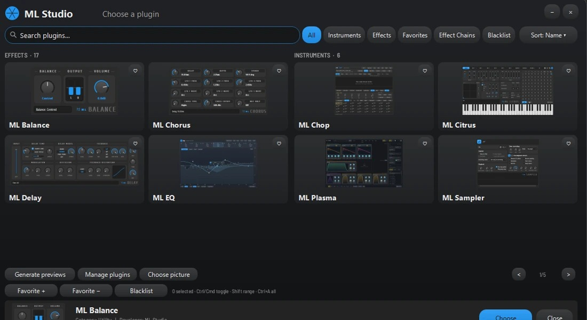
Open the picker from the rack or an effect slot to search for the right type of plugin. F8 opens the general picker. Check the target before choosing, since an effect goes to a Mixer insert and an instrument goes to the rack.
Use the installed and favorites filters to narrow the list. If a plugin is missing, check its blacklist status and scan results in Settings > Plugins.

### Recover a missing plugin or preset
Keywords: missing plugin wrong format vst3 clap preset blacklisted
Guide: plugin-scan
Check the plugin name and format the project expects. Install that version when available, add its folder to the plugin manager, and run a scan.
If an effect slot opens with a missing plugin, preserve a copy of the project before replacing the slot. Compare the replacement's sound and reconnect automation where needed.

### Load and save presets
Keywords: preset vstpreset fxp fxb ospreset patch bank browse previous next
Use the arrows or preset menu in the plugin wrapper's title bar to step through presets. The menu offers browsing and saving your own presets where supported.
Drop a compatible preset onto the intended plugin window or slot to load it there. Use Save preset as to preserve an edited version before switching to another preset.
Host-loaded state presets prepare while the current sound continues playing. When ready, the selected instrument or effect switches with a short smoothing ramp; a rejected preset leaves the current one in place. Held notes restart with the new sound, and routing and automation stay connected. Existing effect tails and a plugin's internal voice state are not carried across. Changes made inside a plugin's own preset browser remain controlled by that plugin.

### Use an ARA audio editor
Keywords: ara melodyne plugin audio edit compatibility
Install a compatible ARA editor for your platform. Open it through the audio clip's ARA action where available and let it read the clip.
Complete pitch or timing edits in the editor, then save the project. Some clip operations, including inline warp, require rendering the ARA edit first.

### Browse samples and release history
Keywords: browser folders sample preview presets plugin downloads changelog
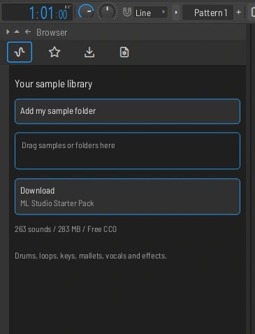
Guide: browser
Use the Browser tabs to find samples, presets, projects and plugin downloads. Add your own folders in Settings > File to keep libraries easy to find.
Use the sample preview controls to audition files before placing them. Open Help > Change Log to browse or search the bundled release history offline.

### Discover free plugins
Keywords: plugin downloads favorites freeware open source portable compatibility installation

Open Browser > Plugin Downloads. Show opens filters for Favorites, Native download, Portable install, Open source and Freeware. Sort switches between categories and alphabetical names. Search matches every word across names, descriptions and licences. Reset filters and search returns to the full catalog.

Click the star beside a plugin to save it to your profile's download favorites. These are separate from favorites in the installed Plugin Picker. Download cards distinguish portable packages, installers/archives and website-only entries. Get from developer opens the official website; some free plugins require a vendor account or manager. Complete the vendor's installation, then click Scan Plugins. A downloaded installer is not proof the plugin is installed.

Direct downloads are checked against the catalog checksum before opening. Cancel stops the current download. Downloads opens the package folder. Hide the discovery controls under Settings > Visibility > Browser > Plugin Downloads filters and favorites. Hiding them shows the unfiltered category browser and preserves your saved favorites and choices. Hiding the whole tab does not remove any installed plugins.

### Browse samples, favorites and the Starter Pack
Keywords: browser samples favorites search tags folders preview volume loop normalize start pack download cc0
Open the Samples tab and use Add my sample folder or drag a folder into the Browser. Search and filter your library, star items for Favorites, and audition a highlighted file with Right Arrow. Preview volume and its assigned Mixer route affect listening while browsing. Drag the sound to the Channel Rack to play it as an instrument or to the Playlist to arrange audio.
Use Download ML Studio Starter Pack for the optional collection of 263 CC0 WAVs, including drums, loops, keys, vocal hits and textures. The download starts from that button, can be cancelled, and appears as a Browser library after verification. The samples and download cache together take about 570 MiB.
Dropping audio files into the Samples Browser adds references to their current locations. Keep the original files available. Add or remove library roots under Settings > File. Use the Browser's menu to detach it for a second monitor or dock it back into the main window.
Guide: browser
Related: Browse samples and release history | Discover free plugins

### Browse the current project and plugin parameters
Keywords: browser current project history patterns generators effects used samples initialized controls presets parameter list
Use Current project to locate patterns, generators, effects, samples, initialized controls, project data and Undo history. The tree provides project context when you are trying to identify which item is in use. For reusable sounds, use the plugin database and preset folders instead.
From a hosted plugin's wrapper menu, choose Browse parameters to see host-exposed parameters in the Browser. Use their context actions for automation or controller linking. If a control is missing, check whether the plugin publishes it to the host.
Related: Load and save presets | Create an automation clip | Edit curves and manage targets

### Use Community Samples and the voting board
Keywords: community samples audition upload account votes feature request voting closed genre sound type license
Open Community Samples in the Browser, choose a sound type or genre, and audition a result before dragging it into the Playlist. Community browsing and downloads require a connection. Use your community account to vote or upload.
For an upload, supply the sound type, genre and creator credit, and review the royalty-free license before accepting it. Keep the permission to share the source sound. On the suggestions board, Voting closed means the item is visible and its voting buttons are disabled.
Use the feedback page for bug reports. If you are reporting a reproducible issue, include the exact build and the steps that show it.
Related: Report a problem and check for updates | Browse samples, favorites and the Starter Pack

### Host VST3, VST2, CLAP and built-in plugins
Keywords: plugin format VST3 VST2 CLAP scan paths architecture instrument effect wrapper editor D detach keyboard focus
Install a plugin that matches the operating system and processor, then scan its installation folder from Settings > Plugins. Add instruments to the Channel Rack and effects to Mixer slots. The plugin's native format and identity matter when reopening projects.
Open the wrapper menu for its preset, parameter, compatibility and processing options. The D control switches between an attached editor and a separate window. Keyboard focus and typing-piano priority determine whether unmodified keys play notes, go to the plugin, or run DAW shortcuts.
A missing plugin can leave a saved slot or channel that cannot process. Check the format and scan error first. Preserve the project before substituting another plugin. Use a render to share the sound with someone who lacks the original plugin.
Related: Find installed plugins | Recover a missing plugin or preset | Use an ARA audio editor

## Stock instruments
Overview: Learn the built-in samplers and synthesizers.

### Play and shape samples in ML Sampler
Keywords: sample sampler root note loop start end envelopes reverse pitch

Open the wrench tab for the sampler's note effects. Choose an arpeggiator direction, then set the speed, gate, octave range and chord source. Select **Held notes** to use the notes you play, or pick a chord or scale to build from the lowest held key. Turn Time all the way up to hold the first arpeggio note.

Turn up **Feed** to add tempo-synced note repeats. Adjust their spacing, count, pan, pitch and filter modulation. **Fat mode** plays closely spaced stereo repeats. Use the **Vol** and **Key** tracking tabs to map velocity and note position to pan, Mod X and Mod Y, relative to each tab's **Mid** point.

These settings are saved with the sampler channel. **Settings > Visibility > Plugin windows > Sampler note effects** hides the controls and keeps their playback settings active.
Load a sample into a sampler channel. Set the start and end, pitch or root note, and loop behavior to suit the sound. Open Piano Roll and play notes at different pitches to check it.
Use the channel's envelopes and filters to shape playback. Keep long files on disk when supported if you need to reduce memory use.

### Design sounds with ML Wave
Keywords: synth oscillator wavetable modulation lfo envelope unassign

Add ML Wave as an instrument and choose a preset as a starting point. Change oscillator and filter settings while playing a few notes, then shape the sound with the envelope.
Assign an LFO or envelope to a control to add movement. Right-click a modulated control to manage or remove its assignment. Save a new preset before changing patches.

### Design sounds with ML Plasma
Keywords: ml plasma gridline wavetable synthesizer oscillator modulation preset

Add ML Plasma from the instrument picker. Use its oscillator and wavetable controls to shape the source, then use the filter, envelopes, and modulation to shape the movement and tone.
Save the project to keep the synth state. Use the instrument's preset controls when you want to reuse a sound in another project.

### ML Trio
Keywords: trio synthesizer oscillator citrus sytrus fm presets

Use ML Trio to layer three oscillators. Start with one waveform. Bring in a second oscillator for octave weight or light detune. Use the third for an additional layer and rebalance each oscillator as the sound changes.
Choose a custom shape to use a sample as one period of the oscillator. Load the sample from the oscillator or sample page. Adjust tuning, stereo balance, envelope and filter, then save a preset for another project.
Related: ML Citrus | Load and save presets

### Slice audio with ML Chop
Keywords: chop slices sample beat slicer pads

Load an audio sample into ML Chop and check its detected slices. Adjust slice boundaries before playing them from pads or MIDI notes.
Use the slices to build a pattern in Piano Roll. Compare playback with the original loop to check the trigger positions and tempo.

### ML Citrus
Keywords: citrus sytrus FM RM operators filters matrix carrier modulator envelope harmonics
Citrus is a six-operator synth. Choose a factory preset, then use the routing matrix to send an operator to the output, a filter, or another operator. A carrier reaches the audio output. Turning up an operator routed into the carrier changes its harmonics.
Work on one operator at a time. Shape its waveform and envelopes, set frequency ratio or offset, then route it. The filter and effects sections shape the combined output. Compare a simple carrier patch with a routed modulation patch to hear the difference.
Citrus can interpret supported Sytrus state in imported FL projects. Play the original and imported versions side by side when migrating a song.

Related: ML Trio | Load and save presets

### Program sampler playback, loops and file options
Keywords: sample reverse pitch time stretch keep on disk preload trim loop metadata tempo root note envelope declicking
Load a sample in ML Sampler and audition it at its root note. Use the sample page to set start, length, reverse, loop behavior, stretch and declicking. If the file supplies tempo or a root note, the appropriate General > Advanced read setting can use it on load. Confirm both when importing a mislabeled file.
Use the envelope and filter controls to shape amplitude and tone. The channel's misc settings include polyphony and note effects. If a shared sample also appears in the Playlist, make an independent source before changing only one version.
Keep on disk streams compatible uncompressed WAV or AIFF samples. Reverse, certain sample effects and stretch modes can require RAM. The sampler indicates the active mode. Drag the edited waveform into the Browser when you want a reusable WAV in Favorites.
Related: Play and shape samples in ML Sampler | Fit a loop or use its detected tempo

### Build a patch in ML Wave
Keywords: wavetable oscillator unison warp phase harmonics filter modulation matrix envelope LFO presets Night Shift keyboard arpeggiator
Start with a factory or user preset. Use oscillator wavetable selection and position to choose a tone, then adjust pitch, unison and available oscillator shaping. Set the filter and amplitude envelope while playing a phrase. Use tempo-synced modulation when the movement should stay on the song grid.
Assign an envelope or LFO to a supported target and adjust its modulation amount. Inspect an assigned control to edit or clear the assignment. Use the on-screen keyboard, scale-aware chords and arpeggiator to try the sound. Mouse and incoming MIDI can both play the instrument.
The Night Shift factory bank and categorized preset browser provide starting points. The wavetable tools can build and audition tables from marked recordings. Save the patch under a new name to reuse it. Content shown in a preset or library browser depends on the installed content.

Related: Design sounds with ML Wave | Load and save presets

### Play slices and edit their boundaries in ML Chop
Keywords: sample slicer slice markers threshold pads waveform BPM audition export
Load a loop into ML Chop, adjust the slice boundaries, and audition individual slices before playing the part from MIDI or the Piano Roll. Moving a boundary changes the material triggered by the corresponding slice. Use the waveform to check that a cut starts at the intended attack.
When building a kit from a rhythm loop, try playing the slices in their original order first. Use snap and the source tempo to establish a close match, then rearrange the notes. Save the project with the source sample available.

Related: Slice audio with ML Chop | Fit a loop or use its detected tempo

## Stock effects & editors
Overview: Look up each ML effect and audio editor.

### ML Tesla time stretch and pitch shift
Keywords: Tesla audio editor duration pitch semitones Signalsmith stretch

In Tesla, select the audio to change, or clear the selection to process the whole sample. Open Tools > Time stretch / pitch shift, or click the stretch tool. Duration changes the length independently of pitch: 200% is twice as long; 50% is half as long. Pitch uses semitones: +12 is one octave up. Click either value to type an exact number, or use its minus and plus buttons. Duration supports 25–400%; pitch supports -24 to +24 semitones.

Apply renders in the background and shows Processing. Cancel or Escape keeps the original audio. Wait for a cancelled render to finish before opening another. On success the processed range is selected; Undo restores the previous audio and markers in one step. Source files on disk are never overwritten. Save As or send the edited audio to the Playlist when ready. Markers, regions and loops follow the time change; whole-sample changes also adjust stored sample tempo. The tool supports samples and results up to 20 minutes. Stop recording before processing.

Hide its toolbar button and Tools menu entry in Settings > Visibility > Toolbar extras > Tesla time stretch and pitch shift. Existing audio and applied edits are preserved.

### ML Tape
Keywords: Lemon Tape Airwindows ToTape6 tape saturation soften head bump flutter

Add ML Tape in a Mixer effect slot. Input drives the tape model (-12 to +12 dB); Soften rounds the high frequencies; Head bump adds low-frequency resonance; Flutter introduces pitch movement. Output trims the processed level and Mix blends dry and processed audio. Start with Gentle Warmth or Soft Mix Bus. Match output loudness when judging the effect. Drum Color is more driven; Worn Cassette adds obvious softness and movement. The reel artwork illustrates the effect, not an audio meter.

Knobs support typing values, reset, automation and the usual plugin preset saving. Existing effects and old projects keep their original sound. Lemon Tape uses Chris Johnson's MIT-licensed Airwindows ToTape6 audio processor with Lemon controls; credit and licence are included. This is a creative tape model, not a claim to reproduce one specific physical machine. At very high sample rates, flutter depth is bounded to fit the processor's delay line. Below 22.05 kHz, internal coefficients use a 22.05 kHz floor for stability.

Hide it from new-plugin menus with Settings > Visibility > Toolbar extras > Lemon Tape in plugin menus. Existing instances still play, save and reopen. Plugin Manager's existing Show control also remains available.

### ML Hall
Keywords: hall, reverb, Dragonfly, Freeverb3, early reflections, damping, pre-delay

Add **ML Hall** in a Mixer effect slot for a stereo hall with early reflections and a modulated reverb tail. It is an additional effect; existing ML Reverb instances keep their original sound. Try Vocal Hall or Short Drum Space first. On a dedicated send, use Hall Send - Fully Wet; adjust the channel's send amount to blend the effect.

Decay sets the tail length (0.20–12 seconds). Pre-delay separates the dry attack from the whole wet signal (0–250 ms). Early Balance blends early reflections at 100% with the diffuse late tail at 0%; start around 25%. Diffusion softens the tail's texture. Low Cut and High Cut filter the wet signal, leaving the dry signal intact. HF Decay sets how quickly high frequencies fade relative to the main decay: lower values give a darker tail. Modulation adds movement, Width sets stereo spread (0% is mono), and Mix blends dry and wet. Changes are smoothed; moving Pre-delay can briefly bend the wet pitch, so stop or use gentle changes if unwanted.

Drag a knob, use its wheel, or right-click for the standard value, reset and automation options. Save your settings in a plugin preset or project. The display is a settings illustration, not a live audio meter. Hall geometry and modulation speed are fixed; this is a focused Lemon interface to the Dragonfly/Freeverb3 hall engine, not every control from the original plugin.

To hide it from new plugin menus, turn off **Lemon Hall in plugin menus** in Settings > General > Workspace Visibility > Choose what to show > Toolbar extras. Saved instances still load and play. This option is saved with your profile.

### Clean up audio in Tesla

Keywords: cleanup, clean up, denoise, noise reduction, noise profile, hiss, hum, Tesla, apply to track

Right-click an audio clip in the Playlist and choose **Audio processing > Clean up audio in Tesla**. Tesla opens a copy of the clip's current source audio. It includes the full source file, so a trimmed clip can show more audio than its visible Playlist section. The clip's position, length, fades, gain, stretch settings and routing remain in the Playlist.

For the best result, close the cleanup panel, select at least 100 ms of background noise with no wanted voice or instrument, then open **Tools > Clean up audio (denoise)** and click **Learn selected noise**. Tesla remembers the noise profile for this editor session and clears the selection so the next preview cleans the whole sample. To clean only a portion, close the panel, select that portion and reopen Cleanup. If there is no noise-only section, use **Automatic estimate** and listen carefully; it is an estimate, especially on continuous music.

Start with 12 dB Reduction and 1.50x Sensitivity. Higher Reduction permits stronger attenuation; higher Sensitivity identifies more audio as noise. Click **Preview cleaned** to render and listen. A progress bar appears while processing; Close/Escape cancels processing without editing the sample. Use **Original**, **Preview cleaned** and **Stop** to compare. Preview never changes the document or saved project. Tesla temporarily suppresses its incoming mixer audio during these previews so it does not double up with the audition.

**Apply cleanup** commits the result inside Tesla with one undo step. If you continue editing afterward, the yellow **Apply to track** button at the bottom of Tesla (also in its File menu) returns the edited sample without running denoise again. **Apply to track**, available only when opened from a ML Studio clip, writes a separate cleaned WAV and updates that exact Playlist clip automatically. Other occurrences of the same sample are unchanged. Playlist Undo restores the original clip in one step; the original audio file is never overwritten. The cleaned WAV stays in the project's Rendered/Cleaned folder (or the normal user render folder for projects without a data folder) and is referenced when saving the project. Keep these files with the project when transferring it.

Cleanup uses the current source file. Previously rendered vocal tuning or audio timing is already in that file and stays baked into the cleaned copy; the copied clip does not keep a live link to those earlier editing sessions. Mixer effects are not baked. ARA clips must first be rendered to ordinary audio. If you change the Playlist, source file or source channel while cleanup is open, Apply refuses to replace anything: reopen Cleanup from the intended clip. Changing Tesla's sample length or sample rate also prevents returning it to that clip, because doing so would invalidate its timing. Return links end when the project closes or the operation succeeds.

Tesla also works separately as a **VST3** plugin in FL Studio and other VST3 hosts. Load or drag an audio file into Tesla, use the same cleanup controls, then **Apply cleanup** and **File > Save sample as**. Saved plugin state includes the edited audio. Automatic **Apply to track** is a ML Studio connection; external hosts use Tesla's normal save or drag-out workflow. This is an audio editor that processes the loaded sample, not a live noise gate or an automatic multitrack editor.

This spectral tool targets steady noise such as hiss, fans and hum. It does not separate competing voices or reliably remove individual clicks. Strong settings can damage wanted audio, so compare before applying. Supports mono/stereo, 8–384 kHz, up to 20 minutes and 120 million samples. Noise profiles are not saved across editor sessions. Hide its toolbar tool and Playlist menu action through **Settings > General > Workspace Visibility > Choose what to show > Toolbar extras > Tesla audio cleanup / Playlist cleanup action**; hiding does not change existing audio.

### ML EQ controls and processing modes
Keywords: ML EQ parametric EQ 2 analyzer seven bands dynamic spectral de-harsh phase HQ gain match audition
Use the seven-band overview or the graph to select a band. Drag its node left or right for frequency and up or down for gain. Ctrl-click overview headings to select several bands. The band menu and Band controls drawer expose filter shape, bandwidth or Q, mode and exact values. Use the band power switch to bypass that band.
Regular mode applies a fixed curve. Dynamic mode changes gain according to the signal crossing its threshold. Use attack and release to decide how quickly the gain reacts. Spectral dynamics and de-harsh target narrower activity inside the selected range. Audition a band or the affected signal to locate the problem, then compare in context.
Use A/B, temporary RMS Level match and the analyzer to compare settings. Reset and Invert gain apply to selected bands. Auto fit changes graph scale. The analyzer's Speed menu controls its display, including range, resolution, tilt and averaging where offered.
Quality choices include HQ and linear-phase modes. Modes with reported latency participate in Mixer playback compensation. The overview and floating band card have independent ML EQ visibility switches.

Related: Mix with ML EQ | Read signal levels, latency and plugin load

### ML Limiter
Keywords: limiter compressor gate ceiling lookahead attack release sustain gain sidechain
Use the limiter for peaks or the compressor for level changes over time. Set gain and ceiling while watching the input/output and gain reduction. Shorter timing responds to transients faster. More look-ahead can smooth limiting and adds processing delay.
In compressor mode, set threshold, ratio, knee and timing. To duck a track, send a sidechain to the insert, choose the detector source in the plugin or use Quick Sidechain where available, then check that the reduction follows the trigger. Use the gate controls to reduce low-level signal between events.

#### Parameter names
Gain, Soft saturation threshold, Limiter ceiling, Limiter attack time, Limiter attack curve, Limiter release time, Limiter release curve, Limiter peak window, Comp threshold, Comp ratio, Comp knee, Comp attack time, Comp release time, Comp curve, Comp RMS window, Noise gain, Noise threshold, Noise release time.

Related: Create sends, buses and sidechains | Insert effects, wet/dry mix and plugin bypass

### ML Reverb
Keywords: reverb room size decay pre-delay early reflections diffusion damping dry wet
Add the reverb to an insert for a local space or to a send for a shared space. Room Size, Decay and Diffusion shape the tail. Pre-delay keeps the source attack separate from the first reflection. Use the frequency and damping controls to keep the return from masking the dry sound.
On a send, lower the dry level and blend the amount from each track with its send. On an insert, blend within the plugin or use the slot's wet/dry control.

#### Parameter names
Low cut, High cut, Predelay, Room size, Diffusion, Decay time, High damping, Bass multiplier, Crossover, Stereo separation, Dry level, Early reflection level, Wet level, Mod Speed, Mod Depth.

Related: ML Hall | Create sends, buses and sidechains

### ML Delay
Keywords: delay echo feedback stereo ping pong tempo sync modulation filter diffusion wet dry
Set delay time against the song tempo for rhythmic echoes, then use feedback to decide how long the echoes last. Select the delay mode for the stereo behavior you want. Use filtering to make repeats darker or thinner and modulation to give them movement.
On an insert, blend the repeats with dry sound. On a send, keep the delay wet and blend with the send level. When exporting, choose a tail setting that keeps the last repeats or wraps them if you are making a loop.

#### Parameter names
Input wet, Delay type, Tempo sync, Keep pitch, Time, Delay time R/L offset, Time smooth, Stereo spread, Modulation rate, Modulation time, Modulation cutoff, Diffusion level, Diffusion spread, Distortion type, Feedback level, Filter mode, Feedback cutoff, Feedback resonance, Distortion, Distortion knee, Distortion symmetry, Rate reduction, Bits reduction, Output wet, Output tone, Output dry.

Related: Export settings, metadata and stems | Create sends, buses and sidechains

### ML Chorus
Keywords: chorus modulated delay voice rate depth stereo spread wet
Use Chorus to widen or thicken a sustained part. Start with a shallow depth, then adjust rate, delay and stereo spread while listening in the mix. Greater depth and rate make pitch movement more obvious. Use the mix control or the Mixer slot amount to blend it.
Check a stereo chorus in mono before committing a wide setting. If a sound loses focus, reduce the depth or wet amount.

#### Parameter names
Delay, Depth, Stereo, LFO 1 speed, LFO 2 speed, LFO 3 speed, LFO 1 wave, LFO 2 wave, LFO 3 wave, Cross type, Cross cutoff, Wet only.

Related: ML Stereo Enhancer | ML Stereo Shaper

### ML Soft Clipper
Keywords: soft clip threshold post gain saturation peaks drums clipper
Lower the threshold to round more of the incoming peaks. Set Post level so the output compares at a similar loudness to the bypassed signal. Use it on drums or a bus when you want rounded transients and the resulting distortion.
Adjust the input and threshold together. Compare the output in context, particularly if another processor follows the clipper.

#### Parameter names
Threshold, Post gain.

Related: ML Fast Distortion | Read signal levels, latency and plugin load

### ML Fast Distortion
Keywords: fast dist drive threshold pre post distortion saturation mix
Use the input or pre control to drive the waveshaping stage. Set the threshold and distortion type, then trim the output and blend dry/wet to suit the source. Try a small amount on a bass or drum bus before increasing the drive.
Distortion creates new harmonics and can change level substantially. Check the output meter and compare with the bypassed signal before the next effect in the chain.

#### Parameter names
Pre amp, Threshold, Type, Mix, Post gain.

Related: ML Soft Clipper | ML Tape

### ML Balance
Keywords: utility gain volume balance pan automation
Use Balance for a simple gain or stereo balance change inside an effect chain. It is useful for automation when the Mixer fader also serves as your mix level, or for trimming the signal going into the next plugin.
Place it before a dynamics or saturation effect to change that effect's input, or after it to adjust the result. Use the parameter's context menu to make an automation clip or controller link.

#### Parameter names
Balance, Volume.

Related: Create an automation clip | Set levels, pan and routing

### ML Stereo Enhancer
Keywords: stereo enhancer separation width phase offset pan gain
Use Stereo Enhancer to change separation and channel balance. Adjust phase offset carefully, then listen in stereo and mono. Larger offsets can make the signal wider but can also cause partial cancellation on a mono device.
Set output level to make a useful bypass comparison. A centered bass, kick or lead may need a smaller change than pads or background textures.

#### Parameter names
Pan, Volume, Stereo separation, Phase offset, Phase offset placement, Inversion.

Related: ML Stereo Shaper | ML Chorus

### ML Stereo Shaper
Keywords: stereo shaper matrix left right crossfeed phase invert difference output
The four matrix controls set how much of each input channel goes to each output channel. Use the diagonal for the direct left and right paths and the cross paths for blending or swapping sides. Negative values invert polarity on the corresponding path.
Check stereo and mono after a change. Use delay and phase controls only when you want that relationship to change. A configured difference output can route an additional signal in the ML Studio Mixer.

#### Parameter names
Right into left, Left, Right, Left into right, Delay, Phase, Effects position.

Related: ML Stereo Enhancer | Create sends, buses and sidechains

### ML Transient Processor
Keywords: transient processor attack release sustain shape drums split wet dry
Use the transient control to emphasize or soften an attack and the decay or release control to change the tail. Start with one sound such as a snare. Increase attack for definition or shorten the tail to leave room for the next hit.
Set the effect amount, listen at similar output loudness, and check that softer notes still behave as intended. Use the slot wet/dry blend for parallel transient shaping.

#### Parameter names
Attack, Drive, Release, Gain, Attack shape, Release shape, Split frequency, Split balance, Processing.

Related: ML Limiter | ML Soft Clipper

### ML Pulp Filter
Keywords: pulp filter Love Philter multi filter envelope pattern cutoff resonance series parallel
Pulp Filter combines filter units with modulation and pattern control. Start with one unit and pick its filter type. Adjust cutoff and resonance while listening, then shape the envelope or sequence and check its trigger and tempo behavior.
Turn on additional units for more complex movement. Check the routing and output levels when combining units. Compatible imported Love Philter state uses the project's existing filter settings.

Related: Create an automation clip | ML EQ controls and processing modes

### ML Press
Keywords: press Maximus multiband dynamics compression limiting crossover low mid high master saturation curve
Choose Low, Mid, High or Master and shape that band's dynamics with its transfer curve and timing controls. Set the crossover and audition the individual band while tuning it. Use the Master section and meters to check the combined result.
Use gain before or after the dynamics stage to establish how much signal reaches the curve. Make small moves and compare with bypass at a similar loudness. Projects with supported Maximus state can open in Press.

Related: ML Limiter | Master a mix with Master Assistant

### ML Master Assistant detailed controls
Keywords: master assistant EQ dynamic EQ multiband compression imager maximizer reference loudness ceiling
Open Master Assistant from the Master strip. Opening the editor does not enable processing. Use its on/off control to decide whether it affects playback and song export. Use a representative section for analysis or a reference comparison where offered.
Open Detailed controls to edit Equalizer, Dynamic EQ, Multiband Comp, Stereo Imager and Maximizer. Drag an EQ band for frequency and gain, scroll on it for bandwidth, or use the numerical fields. Dynamic EQ has threshold and reduction controls per band. Multiband compression adds crossover, ratio, attack, release and makeup. Imager width is 100% at unity. Maximizer provides threshold, ceiling, release and mode.
Compare the enabled and bypassed master, check the loudest section and audition the export. Applying a new analysis can replace the current curve, so save a version first if you want to return to the hand-edited result.

Related: Master a mix with Master Assistant | Export settings, metadata and stems

### Record, edit and save audio in ML Tesla
Keywords: Tesla Edison waveform editor record insert audio selection marker region normalize fade sample drag export
Add ML Tesla to a Mixer slot to work on audio from the insert or open it from a Playlist clip when a linked clip action is available. Use its input recording controls to capture audio into the editor. Load an existing WAV when you want to edit a file.
Drag across the waveform to select a range. Use the Edit or Tools menus for the available cut, copy, crop, fade and processing actions. Mark a region or loop to keep its boundaries while auditioning. Compare a tool's preview before applying it and use Tesla Undo to restore the sample.
Save a new sample or drag an edited range into the project. For a linked cleanup session, Apply to track returns a new file to the originating clip. Keep it with the project when transferring the session.

Related: Clean up audio in Tesla | ML Tesla time stretch and pitch shift

### Lemon Filter
Keywords: filter low pass high pass band cutoff resonance sweep
Lemon Filter is a single filter for a Mixer slot. Choose the filter type, then set the cutoff and resonance while the track plays.
Automate the cutoff for sweeps. Lower the resonance or the slot amount if the peak around the cutoff becomes too loud.

### Lemon Flanger
Keywords: flanger comb delay sweep feedback rate depth jet
Lemon Flanger mixes the sound with a short delayed copy whose delay time moves. Set the delay and depth first, then the rate of the movement.
More feedback makes the sweep sharper and more metallic. Check the result in mono when the effect is used on a wide stereo part.

### Lemon Phaser
Keywords: phaser all pass stages sweep feedback rate depth
Lemon Phaser moves notches through the sound. Set the sweep range and rate, then choose how many stages shape the notches.
Feedback deepens the notches. Use a slow rate on pads and guitars, and blend with the dry signal for a subtle movement.

### Lemon Vocoder
Keywords: vocoder Vocodex modulator carrier sidechain bands robot voice
Lemon Vocoder shapes a carrier sound with the level of a modulator, band by band. By default the modulator is the track's own audio and the carrier arrives on the sidechain input: route a synth to the vocoder's Mixer track as a sidechain.
Choose the inputs in the plugin if your routing is the other way round, then adjust the bands and the envelope response until words stay clear. Projects saved with Vocodex open with this plugin.

### Lemon Peak Controller
Keywords: peak controller follower LFO sidechain ducking link internal controller
Lemon Peak Controller follows the level of the sound passing through it and runs an LFO. It offers three controller outputs: Peak + LFO, Peak, and LFO. The sound passes through, or is muted.
Right-click a knob elsewhere, choose Link to controller and pick one of the outputs as the internal controller. Use it to duck a bass from a kick or to move a filter with the level of a drum loop.

### Lemon Formula Controller
Keywords: formula controller expression math a b c song position tempo link
Lemon Formula Controller works out a formula of its knobs a, b and c, the song position, the tempo and the clock, once per tick, and offers the result as a controller. The sound passes through.
Link a knob to its output with Link to controller. A formula that does not compile puts out nothing, so check the formula first when a linked knob stops moving.

### Lemon Drop
Keywords: visualizer spectrum scope meter display audio
Lemon Drop is an audio visualizer for a Mixer slot. It shows the sound passing through it and does not change it.
Put it on the Master or on a bus to watch the mix while you work, and close its window when you need the processor time for other plugins.

## Automation & controls
Overview: Automate parameters, map hardware, and edit shortcuts.

### Create an automation clip
Keywords: automation parameter ramp volume filter right click last tweaked
Related: Edit curves and manage targets | Map a MIDI knob or controller
Right-click a supported knob or plugin parameter and choose Create automation clip. For a plugin parameter that does not expose the command directly, use Tools > Last tweaked or Browse parameters to find it.
Place the automation clip in the Playlist and edit its points. Play the affected section and watch the target control to confirm the link.

### Edit curves and manage targets
Keywords: automation points tension curve link move channel track
Add points on the automation line and drag them to change value and time. Use point menus or curve controls for the shape between points.
Moving the clip to another Playlist row changes where it is displayed. Check its parameter link when you want to automate a different control. Use a separate clip or link for an independent target.

### Map a MIDI knob or controller
Keywords: link to controller midi learn multilink hardware
Guide: midi
Enable your controller in MIDI settings. Right-click a supported parameter and choose Link to controller, then move the hardware control when prompted.
Test the full range and check whether the link should apply to the current project or to a reusable control setup.

### Customize mouse and keyboard behavior
Keywords: controls input bindings modifier shortcut marquee right drag wheel
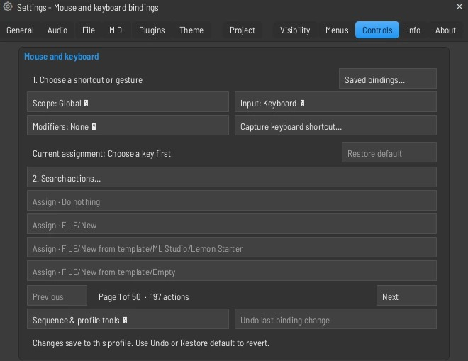
Guide: controls
Open Settings > Controls. Choose an editor context, event and modifiers, then search for an action. Use Capture to record a key and try it in that editor.
A more specific context can override a broader one. Use Restore event to return to inherited behavior, or Do nothing to suppress the gesture.
Clicks and drags can have separate assignments. Set a left click to insert a note and left drag to select a region where those actions are available.

### Restore a shortcut that stopped working
Keywords: shortcut override keyboard binding context hotkey typing keyboard
Guide: controls
Check which editor is active and whether a text field or dialog is taking keys. Turn off Typing keyboard to piano if a note key should be used for editing.
Open Settings > Controls and look for a matching event in the editor and its parent contexts. Use Restore event to remove an override and return to inherited behavior.

### Build action sequences and toolbar buttons
Keywords: macro script lsa saved actions custom toolbar import export
Guide: controls
In Settings > Controls, use Append to build a sequence of compatible editing actions. Save a name to reuse it and choose Pin as toolbar button to make it accessible from the toolbar.
Use Export to back up controls. Import accepts a controls JSON file or a portable .lsa action script. Portable scripts run supported ML Studio actions and do not execute system commands.

### Connect an external assistant with MCP
Keywords: AI assistant external MCP tools working orb approval
Open AI assistant and enable AI control for the session. Save the setup to the Desktop and configure it in a compatible MCP client. Approve the named client in ML Studio when it connects. Disable AI control in ML Studio to revoke access.
The blue Working orb shows when an approved MCP command is running. Hide it under Settings > Visibility > Editor feedback > MCP activity orb.

### Record automation and manage initial values
Keywords: record live automation last tweaked initialized controls event editor init song
Select the recording filter for automation, start the transport and move the supported control during the take. Stop and inspect the recorded result before doing another pass. Use a Playlist automation clip when you want visible points you can reshape and reuse.
Right-click a control or open Tools > Last tweaked to create an automation clip, open an event editor, link a controller or initialize the control, where the parameter supports it. Browser > Current project > Initialized controls lists stored starting values. Remove or update an obsolete initial value if the project jumps to an old setting at start.
Related: Create an automation clip | Edit curves and manage targets | Choose a recording mode and lead-in

### Reuse linked automation on a Playlist track
Keywords: linked automation follow boundaries extend cut trim restore track automation Move
Create automation from the effect on an insert routed to a Playlist track, or choose an existing track automation from the track menu. A new linked automation can span that track's routed clips. The same curve can extend when you add or lengthen material.
Cutting or shortening an automation clip preserves the edited boundaries. Choosing its saved automation from the track menu can restore it later. Check the target link and active arrangement if a control moves unexpectedly. Use a separate automation clip when several targets need independent curves.
Related: Edit curves and manage targets | Attach the Mixer to the Playlist

### Use MIDI output, sync and the MIDI Monitor
Keywords: clock MIDI out sync input external offset port monitor messages midi mapping troubleshoot
Enable the hardware output in Settings > MIDI and match its port to the output destination. Choose a sync type and set the Master sync offset when ML Studio leads. Enable external sync and set its offset when another device leads. Test start, stop and a short recorded passage with the intended clock source.
Use MIDI Monitor to check which port reports notes, CC, transport or pedal input. Dedicated DAW ports often carry control messages separately from keys. Refresh the device list after connecting hardware and check for another application using the same port.
Related: MIDI devices, controller type and sync | Set up a keyboard or mixer controller

## Workspace & settings
Overview: Set up the app, displays, menus and profile defaults.

### Show or hide interface features
Keywords: workspace visibility remove button toolbar settings tabs clip picker
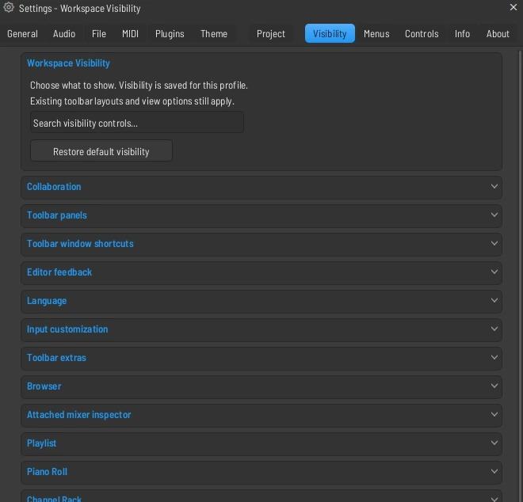
Guide: visibility
Open Settings > General > Workspace Visibility, or choose the Visibility tab. Expand a section or search for the control, then toggle it.
These choices save to your profile and follow you between projects. Use the Playlist menu's Show clip picker panel switch to open or close the picker itself.
Restore default visibility brings back the default show/hide choices. Existing toolbar layout settings still apply.

### Move the Settings window
Keywords: settings options menu move drag position title header floating
Drag the Settings window by its title bar to move it within the workspace. File, Options and other dropdown menus stay anchored to their menu buttons.

The User Guide has its own Detach command. Use it to place the guide on another monitor.
Related: Put ML Studio windows on several monitors

### Customize menus
Keywords: menu layout arrange submenu hide items piano roll channel rack mixer
Guide: menus
Open Settings > Menus and choose the menu to customize. Show or hide entries and use the structure controls to reorder them or place them in submenus.
Menu layouts are saved to your profile. Restore the menu's defaults if a command becomes hard to find.

### Show a window or restore your workspace
Keywords: window missing channel rack mixer browser playlist layout
Use View or the toolbar to reopen the missing window. If its shortcut is hidden, use Settings > Visibility to show it.
A normal app launch restores the windows left open or closed at the last exit, their sizes and positions, and their stacking order. This includes a workspace with every editor closed. Last-session state takes precedence over the startup template or automatically reopened project. Opening a project explicitly still restores that project's saved layout. Plugin editors are restored only for the matching startup project/template and plugin identity. Closing all editors leaves the Browser as it was; its own visibility choice is also remembered.
A project can restore saved window positions. For reusable workspaces, arrange your windows and choose View > Window layout > Arrange windows > Save custom layout as. Save a named .lslayout file. Saved layouts appear in the same menu; Load custom layout opens one saved elsewhere. Saving again under the same name updates that preset after the file dialog overwrite check.
Window layouts include Playlist, Mixer, Piano Roll and Channel Rack positions and sizes, open/closed state and stacking order, Browser width and visibility, detached editor frames, Mixer view, Mixer attachment to Playlist, and the positions of the performance monitor, tempo tapper and touch controller. They do not store project-specific plugin editors or replace notes, clips, routing or effects. Offscreen frames are constrained by the existing window recovery rules. Undo last layout change toggles back to the previous workspace. Delete saved layout asks before removing its file. Escape cancels a save/load dialog.
To assign a hotkey, choose Assign layout hotkey in that menu, then the saved layout. Settings > Controls opens with the layout action selected by its search filter. Capture the key combination, review the current assignment, and click Assign. Use Global scope to switch from any editor. Saved bindings lets you change or remove the shortcut later; Restore default removes that override. Each profile keeps its own layouts and shortcuts. Settings > Visibility > Workspace can hide the layout menu while saved hotkeys keep working.

### Change theme, icons and cursors
Keywords: theme vintage fl 2005 theme editor cursor pack toolbar colors
Guide: theme
Open Settings > Theme and choose a skin or theme. Use the theme controls to adjust colors, icons, cursor packs and Mixer appearance where available.
Use the Theme Editor to preview changes and apply or cancel them. Export the theme if you want to share or reuse it on another installation.

### Audio device and latency
Keywords: settings audio normal advanced driver output device mode sample rate hz buffer length latency show asio panel reset underruns auto close
Open Settings > Audio. Normal shows Output device and Latency. Use a shorter buffer when playing live and a larger buffer if playback clicks or drops out. Advanced exposes the device's sample rate (Hz) and buffer length. Under ASIO, Show ASIO panel opens the driver's own controls in both Normal and Advanced, including when latency presets are available. Shared or Exclusive mode is shown for supported Windows and Linux devices.
Use the status and underrun counters to check that the selected settings took effect. Reset underruns clears the counter so you can check a new configuration. Available options depend on your driver and platform. Greyed controls show when a choice is unavailable.

### Audio processing and recording settings
Keywords: settings cpu generator mixer audio worker limit priority smart disable pdc resampling metronome preview recording format recording offset
Under Audio > Advanced > CPU, Multithreaded generator processing and Multithreaded mixer processing distribute eligible work. Audio worker limit sets the size of the worker pool. Audio processing priority selects the thread priority on supported platforms. Smart disable lets eligible idle effects sleep. Use its per-plugin override if a plugin needs continuous processing.
Mixer contains Plugin delay compensation during playback, playback Resampling quality, Browser preview track, Metronome track, and transport options. A preview or metronome route of 0 uses Master. Play truncated notes on transport controls whether sustained notes can be heard when starting mid-note. Available controls are enabled in the app.
Recording offers 32-bit float, 24-bit PCM, or 16-bit PCM. Recording offset moves recorded audio on the timeline. Positive values place it later. Measure against a reference before compensating for a hardware round trip.

### MIDI devices, controller type and sync
Keywords: settings midi input output external sync ports master sync offsets curve velocity release pickup mcu generic transport learn monitor pedal
Enable the devices you use under MIDI > Input or Output. Match ports for plugins that listen to a particular port. Choose a Controller type per input. Use Generic MIDI for keys and the DAW port in MCU mode for compatible mixer and transport hardware. Use MIDI Monitor or Refresh device list to verify input. DAW MIDI Learn assigns actions to hardware buttons.
Velocity and release links and curves control how incoming dynamics are mapped. Pickup (takeover mode) helps avoid value jumps. Auto accept detected controller, Foot pedal controls note off, and Toggle on release adjust input handling. Omni preview MIDI channel, Song marker jump MIDI channel and Generator muting MIDI channel assign channels to those functions.
Set Sync type and Master sync offset for an enabled output that sends clock or sync, and External sync and its offset when following another device. Check the status before recording to a synced timeline.

### General display and language
Keywords: settings general display ppi scaling high visibility smoothing transparent animations colorful waveforms thick lines force refreshes language note names black notes
General > Display contains Main GUI scaling, display PPI, Pop-ups scaling and Toolbars scaling. These controls let you match the workspace to the monitor and adjust menus and toolbars separately. Animations, Animation refresh rate and Smoothing adjust visual motion. Transparent windows, Transparent menus, Force refreshes, Thick lines, High visibility and Colorful waveforms adjust presentation.
General > Language offers English, French, Spanish, German, Brazilian Portuguese and Italian. Translation coverage varies by surface and plugins can use their own language. Note names and Black notes independently choose English, Germanic or solfege notation and sharps or flats.

### General input and Undo
Keywords: settings general input mouse optimize for double click reset hover menus piano zoom keys undo warnings max levels
Under General > Input, Manage shortcuts opens Controls. Choose Optimize for, Piano Roll zoom keys, Vertical scrolling speed and Horizontal scrolling speed. Click-and-hold & special gesture functions, Use both mouse buttons in step sequencer and Invert pencil buttons adjust editor gestures. Double-click resets faders and knobs and Open main menus on hover are optional and off by default.
Under Undo history, set Maximum undo levels and choose Undo knob tweaks, Alternate undo mode, Put undone recordings in the recycle bin, Show undo history in the browser when undoing changes, and Show recent changes at the top. The clip editors also offer their own pitch and timing history within project Undo.
Manage messages restores or suppresses individual confirmations. Project data size warning controls when the app warns about large project data. System file association and Updates controls depend on your platform and installation.

### General startup and editor defaults
Keywords: settings general miscellaneous advanced startup default template plugin windows focus meters sample read loading
Use Startup project and Default template to choose what opens on launch. Show startup splash screen and Silent startup control startup presentation. Auto name channels, Auto name effect slots, Auto zip empty channels and Auto-route Channel Rack samples to mixer inserts affect new channels or slots.
Auto select linked modules links selection across views. Auto-scroll mixer while routing keeps destinations reachable. Restore previous state after solo brings back the prior mute state. Alternate meter scale, Auto zoom in piano roll and Small scrollbars in editors change their displays. Monophonic painting in piano roll and Select first channel with notes when the pattern changes adjust editing.
Detach all new plugins, Open detached plugins with the main window, Hide plugin window toolbar by default, Disable typing keyboard priority by default and Limit the number of open plugin editors set editor behavior. Create automation clips at the playback position chooses where new automation starts.
Under Advanced, read sample tempo information and Read sample root note use embedded metadata when present. Fast sample preview, Auto keep long audio on disk, Threaded project sample loading and Initialize controls automatically govern loading and initial behavior. Don't limit windows to screen, Cursors scaling and Legacy scaling adjust layout and sizing. Greyed controls depend on platform or availability.

### File, backups and sample libraries
Keywords: settings file autosave location maximum user data folder factory folder browser extra search folders repair optional features reset browser cache
File > Backup sets Autosave frequency, Location and Maximum retained backups. Use the Browser's backup area to reopen an earlier revision. Save deliberately before relying on an autosave as a transfer copy.
File shows the User data folder and the factory content location. Add or remove Browser extra search folders to find sample libraries. Changing a search root changes where ML Studio looks for files. File > Troubleshooting offers Repair optional features and Reset browser cache.

### Plugin manager and plugin editors
Keywords: settings plugins formats search folder find new plugins rescan all rescan plugins with errors combine formats prefer vst clap hide favorite
In Settings > Plugins, enable the folders you want scanned. Add a folder for an installation outside the standard locations. Find new plugins scans additions and Rescan all rebuilds scan results. Use Rescan plugins with errors when retrying failed scans.
Combine formats of the same plugin and the format preference affect which variants appear in the picker. Use the table to filter, favorite, or hide plugins. Use the plugin window's D control to detach or attach its editor. Projects keep the plugin identity and still need a compatible installation on each computer.

### Themes, icons, cursor and mixer design
Keywords: settings theme appearance skins adjustments theme editor mixer skin designer icons fonts cursor packs note colors brightness
Settings > Theme lets you choose a skin and theme and adjust colors and brightness. Audio and automation clips use note colors changes how clip colors are derived. The Playlist scrollbar style is also adjustable when its visibility option is enabled.
Open Theme Editor for individual color and shape settings or Mixer Skin Designer for mixer-specific appearance. Editing a mixer body, panel, slot or fader color selects the editable Theme colors finish automatically; the Traditional and Full layouts both use those colors. Editing a skin component color enables that custom component. Apply keeps the changes, and Cancel restores the previous appearance. Icons & Fonts lets you choose icon and cursor packs independently, override individual glyphs, and change the interface font. Save a preset or export the theme to reuse the appearance.

### Project data, time and credits
Keywords: settings project data folder ask copy used samples ppq timebase signature division panning law crossfades info debug about licence
Project > Data folder controls where project audio is stored. Choose when to ask for a data folder and whether to Copy used samples to the project folder. Time settings sets Timebase (PPQ) and a time signature or time division. Changing the signature changes the bar grid. Use the tempo control to change BPM.
Project > Advanced includes Panning law and Play truncated notes in clips. Playlist contains Automatic crossfades and the default for new projects. The Info tab saves the title, author, genre, comments, web link, and Show info on opening. It also shows working time, with a reset control.
About shows version, licence and product links. Debug can be enabled in Workspace Visibility for diagnostics. Debug details can help when describing a reproducible problem.

### Workspace visibility, menus and controls
Keywords: settings visibility choose what to show menus customize controls bindings portable action shortcuts theme toolbar
Visibility lists the current show/hide controls by workspace area. Search for an exact label to find its switch. Open it directly from Settings > Visibility or through General > Workspace. The settings apply per profile, and Restore default visibility restores the shipped choices.
Menus lets you organize menu entries and restore their structure. Controls manages keyboard shortcuts, mouse bindings, action sequences, and toolbar buttons. Back up your controls with Export and import a supported controls file or portable action script when moving profiles.

### Put ML Studio windows on several monitors
Keywords: dock detach D second monitor external screen detached guide browser mixer playlist piano roll plugin windows layout
Use a window's Detach command or D control where offered, then move its native title bar to the second monitor. Use Dock or D again to return it to the workspace. For the Browser, use its menu. For Help > User Guide, click Detach or Dock at the top of the guide.
The guide's separate window keeps its own article, query and scroll. The main workspace can keep editing and playing while the guide is open. Use the native close button to hide it and Help > User Guide to reopen it. Window recovery uses the available monitors to bring a saved frame back into view if a display is removed.
Project and named workspace layouts cover the supported editors. Use the guide's own controls for its position and docking mode.
Related: Browse or search the User Guide | Show a window or restore your workspace

### Arrange the toolbar and utility windows
Keywords: toolbar presets panels detached tap tempo touch controller plugin performance project picker
Use View > Toolbars to choose visible panels and access toolbar layout editing. Move or hide sections you rarely use and use Workspace Visibility to expose optional buttons. Save a layout if you switch between recording, arrangement and mixing setups.
Open the Tempo tapper to estimate BPM from taps, the Touch controller for on-screen control, and Plugin performance monitor to inspect processing load. The Project Picker helps locate project patterns, clips and other sources. Plugin Picker opens the installed instrument/effect catalog.
Related: Show or hide interface features | Build action sequences and toolbar buttons | Read the toolbar and project time

## Files, export & sharing
Overview: Move projects, export audio, and collaborate.

### Save, reopen and recover a project
Keywords: lmn flp backup save as autosave portable missing files
Use File > Save to keep working or Save As to make a separate version. Keep the project's audio files and installed plugins available when reopening it.
Use the File menu's ZIP project export when you need a portable project and its audio. Third-party plugins must be installed on the destination machine.
If a project crashes or a save is lost, check the available backups before overwriting the original project.

### Import a project from FL Studio
Keywords: flp compatibility import report missing sample plugin migrate
Open the FLP through File > Open. Review the Project Import Report if it lists missing files or unresolved links, and point the project to the original samples where needed.
Install compatible plugin formats before opening a project that uses third-party plugins. Check playback, automation, routing and settings against the original, then save a separate working copy.

### Export a finished song, stems or MIDI
Keywords: export render wav mp3 stems multitrack midi
Related: Send a project with its audio files | Freeze or bounce a track
Guide: export
Choose Song mode and confirm the arrangement. Use File > Export audio to open the export form.
Export audio opens in Easy mode with 24-bit WAV and 320 kbps MP3 options. Pick either or both. Easy uses stereo and the standard render settings. The Advanced tab has additional formats, source range, quality, effects, and split mixer tracks. Advanced export choices save separately.
Use WAV for a full-quality mix, MP3 when a smaller listening copy is useful, and MIDI for notes and timing. Use split Mixer tracks when you need separate audio stems.
Listen to the exported file and verify its start, end, levels and effects before sending it.

### Send a project with its audio files
Keywords: share project pack zipped audio samples collaborate
Guide: export
Use File's ZIP project export to gather the project and its referenced audio files. Open a copy of the archive to check that it contains what the recipient needs.
Tell the recipient which third-party plugins and formats the project uses. For a collaborator without those plugins, include audio renders of important tracks.

### Collaborate on a project
Keywords: live collaboration host join invite network transport follow recovery
Choose File > Collaborate. Save the project, stop playback, and host on a reachable address. Share the invitation privately. Your collaborator opens the same dialog and joins with that invitation. Both users need compatible ML Studio builds and their own copies of the plugins used in the project.
Reopen Collaborate for session status, playback following, conflict resolution, recovery files, and End or Leave. Each computer renders its own audio. Use a LAN or shared private VPN for direct connections.

### Native projects, folders and templates
Keywords: lmn flp extension file format project data folder copy used samples save new version template delete unused
New saves, backups and ZIP projects use .lmn. File > Open also accepts compatible .flp files and zipped projects. Save on an existing .flp keeps that name. Use Save As to make a separate .lmn copy before editing a migrated project.
Use Save new version for a numbered sibling or Save to new project folder to gather the session in a different folder. Under Settings > Project, choose the project data location and whether to copy used samples. Recording and render folders are part of a portable audio project.
Use Save as template and select it from File > New from template or set it as the General default. Revert to last backup when that is the desired recovery point. Delete unused files and save project is a project cleanup action. Read its confirmation and keep wanted source and archived versions before running it.
Related: Save, reopen and recover a project | Import a project from FL Studio | Send a project with its audio files

### Import and export MIDI files
Keywords: standard MIDI SMF import tempo map channel track piano roll export midi notes
Choose File > Import > MIDI file and review how tracks, channels and tempo are imported. Use Piano Roll's import when the file should populate that editor's target. Drop a MIDI file into the Playlist when you want a new pattern at the drop position.
Use File > Export MIDI for the supported note and timing data. To transfer instrument sounds, mixer processing and audio clips, also export audio. Reopen the MIDI file in the receiving app to check tempo, channel assignment and note lengths.
Related: Edit several MIDI clips on one timeline | Export a finished song, stems or MIDI

### Export settings, metadata and stems
Keywords: WAV FLAC MP3 OGG dither stereo mono gapless HQ plugins tail loop points markers tempo resampling split mixer tracks
In File > Export audio, use Easy for 24-bit WAV or 320 kbps MP3. In Advanced choose WAV, FLAC, MP3 and OGG as needed. Set format depth or bitrate, sample rate, stereo or mono and interpolation quality. Check the output path and filename before exporting.
Choose Song or Pattern and Whole or Selection where available. Tail can cut, ring out, or wrap back to the start for loops. Insert effects and Master effects are independently enabled. HQ for plugins asks hosted processors for offline high-quality mode where supported. Dither is available for integer formats that support it.
Enable Split mixer tracks for WAV or FLAC stems and choose whether to include Master. WAV metadata options can write tempo, Playlist markers, loop points and pattern note markers. Gapless MP3 metadata helps compatible players handle encoder delay. Verify start, end and levels in the final files.
Related: Export a finished song, stems or MIDI | Freeze or bounce a track

### Resolve collaboration conflicts and recover sessions
Keywords: network LAN TCP 32190 host guest invite TLS project shared conflict recovery disconnect local copy follow playback
Hosts and guests need compatible builds. Host after saving and stopping playback. Share the invitation privately, since it grants access to download and edit the project. The guest gets a fresh local project and sample folder. Each computer supplies its own compatible plugins and licenses.
Play independently or turn on Follow host playback for transport and position following. Audio is rendered on each computer. Remote structural or plugin-state edits may wait for local gestures, dialogs or playback to finish.
If the same item changes on both machines, open Collaborate and choose Keep my version or Use shared version. A local Before conflict copy is saved before resolving. Use Open recovery folder to find checkpoints and recovered work after a disconnect. End / leave keeps local projects. If hosting across networks, use a reachable LAN or private VPN address, or configure the host's firewall and port forwarding.
Related: Collaborate on a project | Send a project with its audio files

## Menus
Overview: Find commands in the main menus, editor menus, and right-click menus.

### How menus work
Keywords: menu dropdown popup context right click checkbox radio disabled arrow submenu shortcut customize keyboard mouse hover
Open the main menus at the top of the workspace. The small menu button inside an editor opens that editor's settings and tools. Right-click an object such as a clip, track header, channel, effect slot or knob to act on that specific object. Some tools use right-click for editing or erasing in the grid. Use the object's title, menu button or designated control to open its menu.
- A right arrow opens a submenu. Move onto the row and into its submenu to reach the command. A check mark shows an on/off choice. A radio mark shows the selected member of a mutually exclusive group.
- A greyed command needs a different selection or project state, or is unavailable in this build. For example, a project must be saved before it can revert to its own backup. Audio, pattern and automation clips offer different commands.
- The key printed beside a command is its shortcut in the relevant context. Settings > Controls can change the effective binding. When Typing keyboard to piano is active, many bare letter keys play notes.
- A menu's wheel moves among available rows. A menu that spans several columns can scroll sideways to reveal more items. Click outside or press Escape to close without choosing a command. Under General > Input, Open main menus on hover changes how the main menu titles open.
Related: Main menu command index | Customize menus | Keyboard and mouse shortcuts

### File menu
Keywords: File new recent template save as version import MIDI export stems ZIP project cleanup backup collaborate
New starts from the default template. New from template lists available factory and user templates. Open accepts a project or supported ZIP, and recent projects appear in the File menu once you have opened them. More shows older entries.
- Save updates the current project. Save As creates a separate project name or location. Save new version creates a new numbered .lmn. Save to new project folder changes the project folder, while Save as template makes a reusable starting point.
- Import contains MIDI file, Project import report and Resolve imported files. Open is also the entry point for compatible FLP projects. Use the report and resolver to review what needs attention.
- Export audio opens the Easy/Advanced render form. Export MP3 goes directly to an MP3 export setup, Export MIDI writes musical data, and Export zipped project gathers the project and referenced media. Split mixer tracks is in Advanced audio export.
- Revert to last backup reopens the saved recovery revision. Delete unused files and save project cleans project data after confirmation. Use Collaborate to host or join a shared session. Exit uses the normal save/discard flow.
<!-- menu-reference File -->
Related: Native projects, folders and templates | Export settings, metadata and stems | Collaborate on a project

### Edit menu
Keywords: Edit undo redo history last action project snapshot alternate undo
Undo reverses the most recent project edit it can restore. The label can identify the action. Redo restores an undone edit where the current history and undo mode allow it. A new edit can change the redo path.
Choose Undo history to see recent project edits in the Browser. General settings controls history depth, knob tweak history, alternate undo behavior and history presentation. Audio Timing, Vocal Tuning and some plugin editors also provide their own local history controls. Check the active editor before undoing a detailed clip or plugin change.
<!-- menu-reference Edit -->
Related: Undo and redo | General input and Undo

### Add menu
Keywords: Add generator instrument effects Sampler Layer audio clip automation clip More plugins picker category vendor
Use the instrument entries to add a Channel Rack generator. Sampler creates a sample-playing channel. Audio clip and Automation clip create their respective sources. Layer is a channel for layered instrument triggering. Pattern opens a new pattern workflow.
Use Effect to select an effect for the Mixer. Choose the destination insert first. Plugin picker or More plugins opens a broader choice of installed instruments or effects. Use Categories, Simple or By vendor to change how plugin lists are grouped. Installed names and favorites depend on your plugin database.
Refresh plugin list performs the fast discovery path. Manage plugins opens scanning, paths and plugin filters. Use the regular plugin scanner after installing a plugin that does not appear in the picker.
<!-- menu-reference Add -->
Related: Add, replace and route an instrument | Find installed plugins | Insert effects, wet/dry mix and plugin bypass

### Patterns menu
Keywords: Patterns list select empty F4 find rename color time signature transpose clone insert delete move split render
The pattern list selects the active pattern. Find first empty and Find next empty create or select available pattern slots. The no-naming version skips the naming prompt. Use Rename and color, Change color or Random color to distinguish parts.
Select in playlist locates occurrences in the active arrangement. Open in project browser locates it in the Browser. Set time signature and Transpose act on the chosen pattern. Insert, Clone, Delete, Move up and Move down manage the pattern list.
Split by channel separates a multi-channel part. Quick render as audio clip uses the quick render workflow. Render as audio clip opens options. Render and replace substitutes the audio in the arrangement.
<!-- menu-reference Patterns -->
Related: Manage and render patterns | Program steps and patterns | Build an arrangement

### View menu
Keywords: View windows browser picker toolbars layout Arrange windows Into workspace detach close all tempo tapper touch controller
Show Playlist, Piano Roll, Channel Rack, Mixer and Browser from View or their toolbar shortcuts. Project Picker locates project material and Plugin Picker lists installed plugins. Tempo tapper and Touch controller are separate utility windows. Plugin performance monitor helps identify processing load.
Toolbars contains panel and layout controls. Arrange windows provides named workspace presets, Undo last layout change, and layout hotkey assignments. Into workspace brings editor positions back into the available workspace. Background controls the workspace appearance where available.
Close all windows closes editor windows, Close all plugin windows closes plugin editors, and Close all unfocused windows keeps the active editor. Browser-related entries jump to History, Patterns, Generators, Effects, Remote control and Plugin database where offered.
<!-- menu-reference View -->
Related: Show a window or restore your workspace | Put ML Studio windows on several monitors | Arrange the toolbar and utility windows

### Options menu
Keywords: Options audio MIDI general file theme plugins project info settings metronome precount snap follow playhead CPU meter
Use the top entries to open MIDI, Audio, General, File, Theme, Plugin Manager and project settings. Project info is the credits and working-time page. The MIDI switches control remote input, MIDI output and master sync.
The switches below them set Typing keyboard to piano, Metronome, Recording precount, Start on input, Blend recorded notes, Step Edit, Loop record, Follow playhead, Enable groups, and Multilink to controllers. Right-click supported toolbar switches such as Recording precount and Typing keyboard to piano for additional choices.
CPU meter chooses a Compact, Classic FL-style or Lemon live monitor display. The AI settings entry, where visible, opens the external MCP setup. Controls, Workspace Visibility and menu customization are available from Settings.
<!-- menu-reference Options -->
Related: Choose a recording mode and lead-in | MIDI devices, controller type and sync | Connect an external assistant with MCP

### Tools menu
Keywords: Tools macros one-click audio recording score logger last tweaked parameters stop sound cancel recording unused samples declicking
One-click audio recording offers supported capture destinations. Dump score log to selected pattern recovers recently played notes within its chosen time window. Clear log clears the note log. Last tweaked and Next to last tweaked address recent parameters and offer supported automation, event or controller actions.
Stop sound stops transport and releases active notes and previews. Cancel recording discards the active take. Select unused channels highlights candidates for cleanup. Purge unused audio clips removes unused clip sources and Reset empty Playlist tracks clears metadata from eligible empty rows.
Switch all or selected audio clip channels to changes their sample playback mode. Declicking controls how sample edges are treated. Switch all plugin editors changes supported attached/detached editor states. Remove all audio editor instances acts on Tesla slots, and the cleanup command for unused files uses the project's saved data folder.
<!-- menu-reference Tools -->
Related: Recover a played phrase with the score log | Record, edit and save audio in ML Tesla | Native projects, folders and templates

### Help menu
Keywords: Help User Guide Change Log About build Community Discord support diagnostics menu
User Guide opens this wiki. Use Contents, search, related articles and the Detach button to keep a reference beside your project. Change Log opens the bundled release history and has its own search.
About opens Settings > About, where you can find the build and license information. Community Discord opens the community link. Use Report a Bug in the app when you want to submit reproducible steps and choose which diagnostics or attachments to share.
<!-- menu-reference Help -->
Related: Browse or search the User Guide | Report a problem and check for updates

### Playlist menu and timeline menus
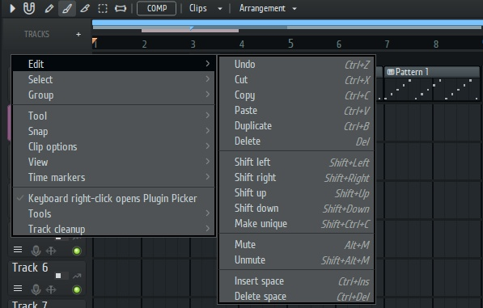
Keywords: playlist triangle options edit tools snap grouping zoom markers visibility arrangement track header ruler
The Playlist's menu offers Edit, Tools, Tool, Snap, Select, Zoom and Time markers. Use Edit for clipboard actions, Duplicate, Make unique, space insertion/removal and clip mutes. Tools includes consolidation, Playlist track export and quick quantization. Tool selects Pencil, Brush, Comp, Slice, Select, Delete, Mute, Zoom, Slip or Playback.
View and visible clip controls determine which editing details are shown. Snap controls timeline placement. Select includes similar or muted sources and time selection around clips. Group and Ungroup change which clips move together. Zoom offers focused, in/out and selection-based navigation.
- Right-click a track header for rename and color, row height, folders and groups, move/insert/delete, mute and solo, track type and routing, take lanes, Freeze and Bounce. Some attached Mixer rows use Mixer ordering and routing.
- Right-click the ruler or a marker for markers, loop placement, time signature, marker behavior and moving content. Marker profiles can save, replace or merge markers. Open the arrangement name menu to switch or manage alternate arrangements.
- Use the Clips menu to show the Clip Picker and choose source visibility. Right-click a source for commands for its clip type.
Related: Select, group and move Playlist tracks | Arrange with groups, markers and zoom | Set up an alternate arrangement

### Audio, pattern and automation clip menus
Keywords: clip context menu audio processing stretch unique stem ARA vocal align pattern edit automation point tension
An audio clip's menu offers Preview, Muted, Rename, Make Unique, Mixer routing, Clip effects and color actions where applicable. Time / stretching includes Detect sample tempo, Make it fit, fit to bars, half/double length and reset duration. Trim clip edges and Stretch clip edges change what the edge drag does.
Use Audio processing for tools such as Strip Silence, Normalize audio clips, ARA editing, Stem separation and Tesla cleanup when available. Audio Timing and Vocal Align expose editing workflows for supported audio. Comping can take a selected range or the whole take. Select & organize includes selecting similar clips.
A pattern clip has Edit pattern, selected MIDI clip editing and pattern stretch actions where relevant. An automation clip works with its linked control and curve. Right-click a point to choose its interpolation Mode, copy or paste a value, type an exact value or delete it. The selected clip and source determine which items appear.
Related: Process clips, render edits and keep source audio | Edit several MIDI clips on one timeline | Edit curves and manage targets

### Piano Roll menus
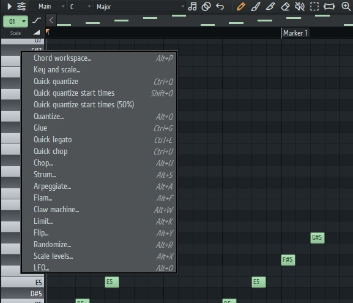
Keywords: Piano Roll menu tools selection edit snap note length color keyboard style control lane MIDI parts stamp ghost
Open the Piano Roll menu for File, Edit, Tools, Stamp, Select, Snap, View, Helpers, Time markers and MIDI parts. Use File to import or export MIDI in the current editor context. Edit and Selected notes offer clipboard operations, moving or copying notes to another channel, shifts, transposition, octave moves and note mute. Selection commands can select all, invert, or select by color.
Tools provides Quantize, Legato, Chop, Glue, Strum, Arpeggiate, Flam, Claw, Limit, Flip, Scale levels, LFO and Randomize where available. A tool may act on all notes when there is no selection. Check its preview or the selection before applying a change.
Use Snap, Note length, Note color and Draw mode for new notes. Slide/glide and portamento change supported note behavior. View and Helpers include keyboard style, note grid highlights, the miniature overview, the control lane and key/scale guidance. MIDI parts switches among clips in the shared timeline. Right-click or double-click the appropriate note or lane control for its own actions.
Related: Use the Piano Roll editing tools | Edit note properties and the event editor | Work with chord and scale tools

### Channel Rack menus
Keywords: Channel Rack options channel context graph filter selected sort fill transpose mixer number
Open the rack Options menu for Add instrument, Edit channels, Organize, Mixer routing, Audio tools and View. Edit channels handles selected channel operations, including clone, mute, delete, transpose and color. Organize handles groups, filters, sorting, moving and cleanup. Mixer routing assigns or selects inserts. Audio tools provides dry consolidation and wet bounce where available.
Right-click a channel name to open Piano Roll, change or insert an instrument, open the graph editor, load a sample, change sample tempo or stretch, set Cut itself, edit pattern steps, consolidate, rename, clone or delete. Fill each 2, 4 or 8 steps gives an even pattern. Advanced fill and step rotation modify the current pattern.
Right-click the Mixer number for destination and selected routing options. Right-click a knob for its value and automation options. Use the LED context for channel mute and solo. Rack View controls the Mixer number display, zipped rows, name alignment, button width and automatic height.
Related: Select and edit several channels | Route selected channels to the Mixer | Program steps and patterns

### Mixer and effect slot menus
Keywords: mixer options track insert slot FX presets spare state scaling PDC dock to routing layout inspector
Open Mixer Options for the inspector, its location and layout, recording-to-Playlist behavior, automatic Plugin delay compensation, View, attachment to Playlist, Detached, unused tracks, Smart Disable and audio editor cleanup. Use the Mixer layout selector to choose Traditional, channel strip, Full and available Vintage views.
Right-click an insert for name, color and icon, track insertion, save effect chain, reset, solo, layout, Dock to and render options. The send controls provide routing actions. Track locks can limit changes on an insert. Choose the insert before opening a menu for its effect list or inputs.
Right-click an effect slot for Replace, Delete, Presets, spare-state comparison, Browse parameters, supported sidechain input, CPU options, Move up/down, View editor, rename/color/icon, and scaling where offered. Some slots have extra options from the hosted plugin. The effect context differs between a filled slot, an empty slot and the insert itself.
Related: Save and reuse effect chains | Attach the Mixer to the Playlist | Create sends, buses and sidechains

### Browser, plugin wrapper and parameter menus
Keywords: browser settings file context favorites tags filter plugin wrapper presets spare state copy value type in automation controller
Open the Browser's arrow menu for content roots, tabs, preview behavior, Starter Pack, docking, appearance, search and folder navigation. Right-click a file or item for its available actions, such as locating the source folder, Favorites, tags, sending to a selected channel or Mixer, and supported filesystem actions. Remove from browser removes its browser entry where offered. Delete file acts on the file itself.
Use the plugin window's menu for presets, Save preset as, spare state, favorite/database actions, Browse parameters, threading or Smart Disable, name/color/icon and Attach/Detach. Instrument wrappers can offer Piano Roll, channel state and routing. Native editor menus are supplied by that plugin.
Right-click an automatable control for Reset, value entry/copy/paste, automation, events or Link to controller where supported. Reset returns a parameter to its default. Type in value is for precise editing. Choose Create automation clip for timeline control or Link to controller for a hardware binding.
Related: Browse samples, favorites and the Starter Pack | Load and save presets | Create an automation clip

### Reorganize or restore a menu
Keywords: Settings Menus customize hierarchy group submenu hide reorder move folder dissolve undo restore default layout
Open Settings > Menus and choose a menu. The selector includes the main menus and supported Playlist, Piano Roll, Channel Rack, Mixer and Browser menus. In editor menus with Customize menus, use it to jump to the matching editor.
Expand a submenu to see its children. Use the visibility control to hide a row, the reorder buttons to move it among siblings, and the move control to put it in an eligible submenu. Add a named submenu for commands you use together. Rename or dissolve a custom group when you change the structure. Hiding a parent also hides its children.
Use the menu editor's Undo to revert a menu change or restore the selected menu's default structure. Layouts are saved per profile. Use Workspace Visibility for feature-level switches and Controls for shortcut assignments.
Related: Customize menus | Show or hide interface features | Restore a shortcut that stopped working

## Reference & support
Overview: Look up commands, defaults, compatibility and fixes.

### Undo and redo
Keywords: history revert mistake ctrl z
Use Edit > Undo or Undo history to step back through project edits. Redo restores edits that were undone if you have not made a new conflicting edit.
Playlist pitch and timing editors offer separate Undo/Redo controls for the active clip. Use the project Undo and Redo shortcuts shown in Edit or your assigned Controls bindings for project history. Each completed gesture, reset, or clip-history action is one project undo step.

### Report a problem and check for updates
Keywords: report bug build update restart troubleshooting support
Use Report a Bug and include your build, operating system, exact steps, expected result and actual result. A small project or screenshot helps when it can be shared safely.
Use the update control to check for a signed release. Save your work before restarting to apply it. If the updater cannot start, ML Studio stays open and shows the error. If installation fails after closing, check the message when ML Studio reopens. You can also install a public update from the official downloads page. **Help > About** opens the page with the build number.

### Main menu command index
Keywords: menu reference complete commands file edit add patterns view options tools help shortcuts
Use this index to look up commands by menu. Available items and key assignments can vary with the selected editor, project state, platform, and your Workspace Visibility and Controls settings. Menus also have contextual submenus for the active clip, channel or plugin.
<!-- menu-reference -->
Related: Keyboard and mouse shortcuts | Customize menus

### Keyboard and mouse shortcuts
Keywords: keyboard shortcut hotkey mouse function keys ctrl cmd alt shift wheel F5 F6 F7 F8 F9 F10 F11 F12
#### Start, save and switch windows
- Space plays or stops. Ctrl+Space plays or pauses. Use PAT or SONG to choose the source.
- Ctrl+O opens a project. Ctrl+S saves. Ctrl+Shift+S opens Save As. Ctrl+N saves a new version.
- F5 opens Playlist, F6 Channel Rack, F7 Piano Roll and F9 Mixer. F8 opens Plugin Picker by default. Ctrl+F8 opens Project Picker, Alt+F8 Browser and Shift+F8 Plugin database. F10 opens MIDI settings and F11 Project info.
- F12 closes editors. Alt+F12 closes plugin windows. Ctrl+F12 closes unfocused windows.
#### Arrange, edit and record
- F4 finds the next empty pattern. F2 names or colors the current pattern. Ctrl+Z undoes. See Edit for the active Redo behavior.
- Ctrl+T toggles Typing keyboard to piano. Ctrl+M toggles metronome. Ctrl+P toggles Recording precount. Ctrl+E toggles Step Edit.
- Ctrl+R opens audio export. Ctrl+Shift+R opens MP3 export. Ctrl+Shift+M opens MIDI export.
- Ctrl/Cmd+Shift-drag can marquee-select notes or clips. Ctrl-wheel zooms where supported. Use the editor's tool and snap menu to check the active behavior.
#### Search and customize
- In the User Guide, Ctrl+K or Ctrl+F focuses search. Enter opens the first result. Escape backs out of a picture, article or search. Page Up and Page Down scroll.
- On Mac, many app commands use Command in place of Ctrl. Settings > Controls shows and edits the bindings for your profile and editor context.
Related: Customize mouse and keyboard behavior | Restore a shortcut that stopped working

### Diagnose missing sound, files and plugins
Keywords: troubleshoot no sound blank audio disabled plugin missing file scan errors underruns reset
1. Verify PAT or SONG, an active pattern or arrangement, and an enabled audio output. Check Master and each source's routing and mute state.
2. Test a sample or instrument already known to play. If only one channel fails, look for a missing sample, missing plugin or a disabled effect that changes the route.
3. Check Audio settings and the underrun counter. Test a stable buffer and use the performance monitor to isolate a heavy plugin. Restart a disconnected interface before scanning unrelated plugins.
4. For a missing file, locate the original and relink it. Save a version after confirming it plays. For a plugin scan error, confirm format and architecture, add its installation folder and rescan errors.
5. If the issue persists, include Help > About's build, OS, driver, sample rate, buffer and steps in the bug report. Attach a small reproducible project if you can share its content.
Related: Fix delay, crackles or no sound | Report a problem and check for updates

### Project compatibility and feature availability
Keywords: FAQ FL Studio FLP lmn compatibility VST ARA native formats performance mode midi scripts versions platforms
Open supported FL Studio projects through File > Open. Compare routing, automation, sample references and third-party formats against the original. Import reports help locate missing items or behaviors that require attention. Keep the original file and save your ML Studio work as a separate .lmn.
Greyed menu entries are unavailable in the current build or context. Playlist Performance Mode and MIDI scripts are not implemented. Choose the supported MIDI Learn or controller profiles for hardware control. Availability of native drivers, ARA editors and optional tools depends on platform and installed components.
Use Help > About to compare builds and Help > Change Log to check what shipped in each release. Download and install the correct architecture for your OS.
Related: Import a project from FL Studio | Set up a keyboard or mixer controller | Install and open ML Studio
